# Analysis Report — Behavioral Mechanics of App-Based Investment Frauds

_Generated by `analysis/run_all.py` on 2026-11-09 10:26 UTC from the files in `data/`. Every number comes from `results/results.json` and `results/tables/`; do not edit by hand. Pre-registered plan: `results/ANALYSIS_PLAN.md`._

App study: 124 consented players (honest 62, fraud 62), 61 completed (honest 39, fraud 22); collection 2026-11-02 to 2026-11-08. Survey: 45 consenting respondents (2026-11-02 to 2026-11-09). All tests two-sided, α = 0.05; bootstrap CIs with 2,000 resamples (seed 42).

## 1. Summary scorecard

Verdict rules (pre-registered): SUPPORTED = primary outcome in the predicted direction with p < 0.05; PARTLY SUPPORTED = predicted direction with 0.05 ≤ p < 0.10, or most secondary outcomes significant in the predicted direction; NOT SUPPORTED = no difference or the opposite direction; NOT TESTABLE = no comparison or too little data; PENDING = needs the external dataset. Verdicts use raw p-values; Holm-adjusted p-values are reported in each section.

| Hyp. | Short | Prediction | Primary result | n | Verdict |
| --- | --- | --- | --- | --- | --- |
| H1 | Dark design | Fraud players deposit more in total (and decide faster, invest more often, verify less, trust more, feel more urgency). | Mann-Whitney U (two-sided): δ = 0.26 [-0.07, 0.55], p = 0.102 | fraud 22, honest 39 | NOT SUPPORTED |
| H1a | Timer / scarcity | Fraud players make the first decision faster than honest players. | Mann-Whitney U (two-sided): δ = -0.11 [-0.40, 0.19], p = 0.494 | fraud 22, honest 39 | NOT SUPPORTED |
| H1b | Locked bonus | More fraud players invest in round 1 (the first real deposit). | Fisher's exact test (two-sided): OR = 1.47 [0.26, 8.30], p = 1.000 | fraud 22, honest 39 | NOT SUPPORTED |
| H1c | VIP levels | More fraud players deposit at least ₹5,000 (VIP 2). | Fisher's exact test (two-sided): OR = 0.53 [0.10, 2.87], p = 0.658 | fraud 22, honest 39 | NOT SUPPORTED |
| H1d | Fake credentials | Fewer fraud players open any T&C, details, badge or About page. | Fisher's exact test (two-sided): OR = 0.07 [0.01, 0.56], p = 0.002 | fraud 22, honest 39 | SUPPORTED |
| H1e | Social proof | Fraud players make the first decision faster than honest players. | Mann-Whitney U (two-sided): δ = -0.11 [-0.40, 0.19], p = 0.494 | fraud 22, honest 39 | NOT SUPPORTED |
| H1f | Mentor chat | Fraud players (who see the chat right before round 4) stake more in round 4. | Mann-Whitney U (two-sided): δ = 0.22 [-0.08, 0.51], p = 0.148 | fraud 22, honest 39 | NOT SUPPORTED |
| H1g | Withdrawal tax | Fraud players pay the tax to unlock their withdrawal. | Share with Wilson 95% CI (no test): share = 64% [43%, 80%] | players 22 | NOT TESTABLE |
| H1h | UX map | Descriptive: rank the seven features by the share of fraud players who felt pushed. | top feature: NDIA badge / certificate 18/22 | fraud 22 | DESCRIPTIVE |
| H2 | Early win | Players randomized to a +8% round 1 escalate their round-2 stake more than players with a flat round 1. | Mann-Whitney U (two-sided): δ = -0.09 [-0.39, 0.22], p = 0.551 | small win 27, flat 27 | NOT SUPPORTED |
| H3 | Small stakes | At ₹500 players open the deal details least and invest most. | Cochran's Q (df = 2): η²_Q = 0.02 [0.00, 0.09], p = 0.336 | players 61 | NOT SUPPORTED |
| H4 | Loss chasing | A higher loss-aversion group predicts topping up after the crash. | Logistic regression: crash_topup ~ loss_aversion_group + fraud + exp_investing: OR = 0.51 [0.24, 1.09], p = 0.084 | players 58 | NOT SUPPORTED |
| H5 | Friend referral | More players join the Diamond Pool when the invite comes from a friend. | Fisher's exact test (two-sided): OR = 0.58 [0.19, 1.70], p = 0.416 | friend 30, ad 31 | NOT SUPPORTED |
| H6 | Test withdrawal | Players offered the ₹500 test withdrawal deposit more right after it. | Mann-Whitney U (two-sided): δ = -0.09 [-0.36, 0.21], p = 0.542 | allowed 33, not offered 28 | NOT SUPPORTED |
| H7 | House money | More is put into the Gold Plan when it is funded from the Profit wallet than from Main. | Mann-Whitney U (two-sided): δ = -0.05 [-0.34, 0.23], p = 0.714 | profit wallet 29, main wallet 32 | NOT SUPPORTED |
| H8 | Literacy paradox | Literacy coefficient not negative; overconfidence coefficient positive. | App: b = 0.24 [-0.25, 0.73], p = 0.331; NFCS Investor (targeted): OR = 2.22 [1.61, 3.06], p < 0.001 | players 61; NFCS Investor 2,672 | PARTLY SUPPORTED (app + dataset) |
| H9 | Bias by group | Bias slopes on the trap score differ between male and not-male players (app); by age, income and gender for victimization (dataset). | app: exploratory bias × gender model; NFCS State (lost money): gender p = 0.145; age p = 0.005; income p = 0.702 | players 58, male 40, not male 18; NFCS State 25,539 | SUPPORTED (app + dataset) |

Effect sizes: δ = Cliff's delta (−1 to 1; for a yes/no outcome it equals the difference in shares), OR = odds ratio, η²_Q = Cochran's Q effect size, b = regression coefficient; brackets = 95% CI.

## 2. Data and attrition

**Read this before any hypothesis result.**

Of 124 consented players, 61 reached the report card. Completion: honest 39/62 (63%, 95% CI 50%–74%) vs fraud 22/62 (35%, 25%–48%); Fisher p = 0.004, odds ratio of completing (fraud vs honest) 0.32 [0.16, 0.67].

No other randomized factor changed completion (pool_source p = 1.000; reinvest_framing p = 0.720; round1_outcome p = 0.720; withdrawal_offer p = 0.473).

Where drop-outs stopped (honest vs fraud): during profile (before the home screen): 5 vs 8 (Fisher p = 0.559); on the home screen: 6 vs 11 (Fisher p = 0.296); after the home screen (in the game): 12 vs 21 (Fisher p = 0.103). The profile screens already looked different (fraud neon look and avatar picker), so "before the home screen" means before any money or game mechanic, not before any visual difference.

Players who stopped on the home screen: honest 6, fraud 11; 0 of them made the first Invest/Skip decision. 11 of the 11 fraud players among them had closed the VIP pop-up first, so they left while looking at the fraud dashboard.

Randomization among completers: skin is independent of every other factor (smallest Fisher p = 0.108). 3 players gave inconsistent spin answers (excluded from H4); 0 CRT answers were not numbers; 1 player had duplicated round events (first event used).

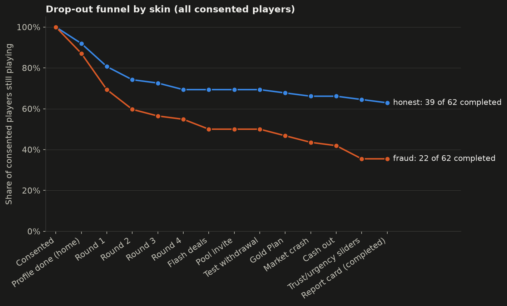

| Milestone | Step | Honest reached | Fraud reached |
| --- | --- | --- | --- |
| Consented | g:profile:0 | 62 | 62 |
| Profile done (home) | g:home | 57 | 54 |
| Round 1 | g:round:1 | 50 | 43 |
| Round 2 | g:round:2 | 46 | 37 |
| Round 3 | g:round:3 | 45 | 35 |
| Round 4 | g:round:4 | 43 | 34 |
| Flash deals | g:deal | 43 | 31 |
| Pool invite | g:pool | 43 | 31 |
| Test withdrawal | g:withdraw | 43 | 31 |
| Gold Plan | g:reinvest | 42 | 29 |
| Market crash | g:crash | 41 | 27 |
| Cash out | g:cashout | 41 | 26 |
| Trust/urgency sliders | g:react:7 | 40 | 22 |
| Report card (completed) | g:report | 39 | 22 |

### What the attrition means for the H1 results

Fraud players dropped out more, so the fraud finishers are likely the players who were more willing to engage with a pushy app (or more patient with a longer game). Possible direction of the bias for each H1 result, comparing fraud finishers with all fraud starters:
- **Amounts and investing (total deposited, round-1 investing, round-4 stake, VIP):** if disengaged or sceptical players left, the remaining fraud players are the more willing investors, which would make fraud look *higher* than it would be for everyone randomized: a bias towards H1. The ITT rerun (round 1 only) is the check for this.
- **Verification (H1d):** if sceptical players who would have checked the app left instead, fraud finishers verify less partly because of who stayed: a bias towards H1d. The fraud skin also had more to verify (badge), which works against H1d; the two cannot be separated.
- **Trust and urgency ratings:** finishers of a pushy app are likely the less suspicious players, a bias towards higher fraud trust; the observed fraud trust is nevertheless not higher than honest trust, so selection cannot have created a trust effect here.
- **Decision time:** players who left on the home screen never made the first decision, so the ITT timing rerun cannot include them; fast and slow leavers are both possible, the direction is unknown.
- **Trap score:** traps from the later screens are counted only for finishers; if quitters were the players who would have avoided traps, the fraud trap score is biased upwards.

**Intention-to-treat check (H1 and H2, everyone who reached the home screen):** conclusions change for H1 round-1 stake: completers p = 0.090 → ITT p = 0.037. Details are in the robustness notes of H1 and H2.

## 3. Hypotheses

### H1 — Dark design overrides deliberate judgment

**Verdict: NOT SUPPORTED** — predicted direction but not significant (primary p = 0.102 ≥ 0.10; 2 of 6 secondary tests significant in the predicted direction).

**What we claimed.** Participants using the fraud-style app decide faster, invest more often and in larger amounts, verify less, and rate the app as more urgent and trustworthy than participants using a plain version with the same returns.

**How the experiment tests it.** Players were randomly assigned to the fraud skin ("ZenTrade X") or the honest skin ("ZenTrade"). Both skins run the same scripted market, amounts, returns and payoffs (checked by an automated skin-parity test); only the presentation differs. So any difference between the two groups can only come from the design layer, not from different incentives. The primary outcome is the total amount a player put in over the whole game; the secondary outcomes cover each part of the claim (speed, investing, verification, ratings, traps).

**The maths.**

```text
total_deposited = Σ round stakes + Σ deal stakes + pool + post-withdrawal deposit + Gold Plan + top-up
trap_score_shared8 = Σ of the 8 trap flags both skins share (0–8)

Mann-Whitney U, two-sided; effect = Cliff's δ = P(X_fraud > X_honest) − P(X_fraud < X_honest)
H0: P(X_fraud > X_honest) = P(X_fraud < X_honest)      (δ = 0)
H1: P(X_fraud > X_honest) > P(X_fraud < X_honest)      (δ > 0, tested two-sided)

Moderator (exploratory): log(1 + total_deposited) = β0 + β1·fraud + β2·crt + β3·fraud·crt + β4·exp_investing
                         + β5·trading_app + ε   (HC3 SEs);  H0: β3 = 0
```

**Result.**

**Primary.** Total deposited: fraud median ₹19,500 (mean ₹23,011, n = 22) vs honest median ₹10,500 (mean ₹15,837, n = 39); δ = 0.26 [-0.07, 0.55], p = 0.102 (Holm p = 0.508) — direction as predicted.

**Secondary.** First decision time: fraud median 19.2 s (mean 26.2 s, n = 22) vs honest median 19.8 s (mean 26.2 s, n = 39); δ = -0.11 [-0.40, 0.19], p = 0.494 — direction as predicted. Invested in round 1: fraud 20/22 (91%) vs honest 34/39 (87%); OR = 1.47 [0.26, 8.30], p = 1.000 — direction as predicted. Verified anything: fraud 1/22 (5%) vs honest 16/39 (41%); OR = 0.07 [0.01, 0.56], p = 0.002 — direction as predicted. Trust rating (1–7): fraud median 3.00 (mean 2.86, n = 22) vs honest median 3.00 (mean 3.54, n = 39); δ = -0.22 [-0.50, 0.06], p = 0.144 — direction opposite. Urgency rating (1–7): fraud median 5.00 (mean 4.95, n = 22) vs honest median 5.00 (mean 4.69, n = 39); δ = 0.04 [-0.26, 0.34], p = 0.810 — direction as predicted. Trap score (shared 8): fraud median 6.50 (mean 6.23, n = 22) vs honest median 5.00 (mean 5.13, n = 39); δ = 0.35 [0.05, 0.63], p = 0.023 — direction as predicted.

**Exploratory.** Log(1 + total deposited) — interaction coefficient (log points): b = -0.85 [-2.58, 0.88], p = 0.336 — direction as predicted. Model R² = 0.12.

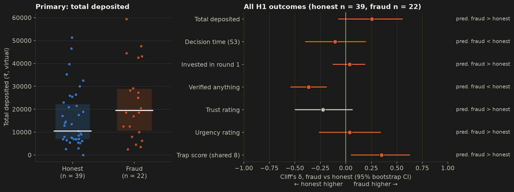

| Role | Outcome | Prediction | Test | Statistic | p | Holm p | Effect [95% CI] | n | Direction |
| --- | --- | --- | --- | --- | --- | --- | --- | --- | --- |
| Primary | total deposited | fraud > honest | Mann-Whitney U (two-sided) | U = 538.50 | 0.102 | 0.508 | δ = 0.26 [-0.07, 0.55] | fraud 22, honest 39 | as predicted |
| Secondary | first decision time | fraud < honest | Mann-Whitney U (two-sided) | U = 383.00 | 0.494 | – | δ = -0.11 [-0.40, 0.19] | fraud 22, honest 39 | as predicted |
| Secondary | invested in round 1 | fraud > honest | Fisher's exact test (two-sided) | OR = 1.47 | 1.000 | – | OR = 1.47 [0.26, 8.30] | fraud 22, honest 39 | as predicted |
| Secondary | verified anything | fraud < honest | Fisher's exact test (two-sided) | OR = 0.07 | 0.002 | – | OR = 0.07 [0.01, 0.56] | fraud 22, honest 39 | as predicted |
| Secondary | trust rating (1–7) | fraud > honest | Mann-Whitney U (two-sided) | U = 333.00 | 0.144 | – | δ = -0.22 [-0.50, 0.06] | fraud 22, honest 39 | opposite |
| Secondary | urgency rating (1–7) | fraud > honest | Mann-Whitney U (two-sided) | U = 445.00 | 0.810 | – | δ = 0.04 [-0.26, 0.34] | fraud 22, honest 39 | as predicted |
| Secondary | trap score (shared 8) | fraud > honest | Mann-Whitney U (two-sided) | U = 579.00 | 0.023 | – | δ = 0.35 [0.05, 0.63] | fraud 22, honest 39 | as predicted |
| Exploratory | log(1 + total deposited) | fraud effect smaller for CRT-correct players (interaction < 0) | OLS with HC3 SEs: log1p(total_deposited) ~ fraud × crt_correct + exp_investing + exp_trading_app | t = -0.96 | 0.336 | – | b = -0.85 [-2.58, 0.88] | players 61, fraud=0, crt=0 11, fraud=0, crt=1 28, fraud=1, crt=0 8, fraud=1, crt=1 14 | as predicted |
| Robustness | first decision time | fraud < honest (outliers > Q3 + 3 IQR removed) | Mann-Whitney U (two-sided) | U = 344.00 | 0.477 | – | δ = -0.11 [-0.43, 0.20] | fraud 21, honest 37 | as predicted |
| Robustness | round-1 stake | fraud > honest (completers; compare with the ITT rerun) | Mann-Whitney U (two-sided) | U = 539.00 | 0.090 | – | δ = 0.26 [-0.02, 0.53] | fraud 22, honest 39 | as predicted |
| Robustness | invested in round 1 | fraud > honest (ITT: everyone who reached home) | Fisher's exact test (two-sided) | OR = 2.10 | 0.337 | – | OR = 2.10 [0.50, 8.74] | fraud 39, honest 47 | as predicted |
| Robustness | first decision time | fraud < honest (ITT: everyone who reached home) | Mann-Whitney U (two-sided) | U = 1,116 | 0.885 | – | δ = 0.02 [-0.22, 0.25] | fraud 43, honest 51 | opposite |
| Robustness | round-1 stake | fraud > honest (ITT: everyone who reached home) | Mann-Whitney U (two-sided) | U = 1,152 | 0.037 | – | δ = 0.26 [0.03, 0.48] | fraud 39, honest 47 | as predicted |

**Verdict and what the data does NOT justify.**

- A non-significant result is not evidence of no effect: the 95% CI (0.26 [-0.07, 0.55]) is wide enough to include both no effect and a sizeable effect. The data cannot decide between them at this sample size.
- Fraud players dropped out more (22/62 completed vs 39/62 honest), so the fraud finishers are a selected group; a skin difference among finishers is not a clean causal effect of the design.
- The skin comparison shows the effect of the whole dark-design bundle. It does not show which feature caused it (the fraud skin switches on all dark-design features at once, so a skin difference cannot be attributed to one feature on its own), and with virtual money it shows behaviour in a game, not real losses.

**Robustness notes.**

- Holm-adjusted p for the primary test within the H1 family (H1, H1a/H1e, H1b, H1c, H1d, H1f): 0.508 (raw p = 0.102). Verdicts use the raw p-value as pre-registered.
- Decision-time outliers (> 68.9 s): 2 honest, 1 fraud. With them: δ = -0.11 [-0.40, 0.19], p = 0.494; without them: δ = -0.11 [-0.43, 0.20], p = 0.477. Same conclusion.
- Intention-to-treat rerun on everyone who reached the home screen (honest 57, fraud 54; 50 non-completers added):
  - invested in round 1: completers OR = 1.47 [0.26, 8.30], p = 1.000; ITT OR = 2.10 [0.50, 8.74], p = 0.337 → same conclusion.
  - first decision time: completers δ = -0.11 [-0.40, 0.19], p = 0.494; ITT δ = 0.02 [-0.22, 0.25], p = 0.885 → same conclusion.
  - round-1 stake: completers δ = 0.26 [-0.02, 0.53], p = 0.090; ITT δ = 0.26 [0.03, 0.48], p = 0.037 → **conclusion changes**.

### H1a — Countdown timers and "only 3 slots left"

**Verdict: NOT SUPPORTED** — predicted direction but not significant (primary p = 0.494 ≥ 0.10; the secondary outcomes are descriptive shares without a test).

**What we claimed.** Countdown timers and "only 3 slots left" on investment plans (urgency, scarcity) lead to faster decisions and more investing.

**How the experiment tests it.** Players were randomly assigned to the fraud skin ("ZenTrade X") or the honest skin ("ZenTrade"). Both skins run the same scripted market, amounts, returns and payoffs (checked by an automated skin-parity test); only the presentation differs. So any difference between the two groups can only come from the design layer, not from different incentives. The timer and the slots counter appear on the fraud home screen, so the first decision time (from the moment the home screen is usable to the first Invest/Skip tap; for fraud, after the VIP pop-up is closed) is the linked behaviour. The feature card asks fraud players whether the timer pushed them.

**The maths.**

```text
decision_time_first_invest = t(first Invest/Skip on S3) − t(S3 usable)

Mann-Whitney U, two-sided; δ = P(T_fraud > T_honest) − P(T_fraud < T_honest)
H0: δ = 0        H1: δ < 0 (fraud faster)
Feature card: share p̂ = k / n with Wilson 95% CI
```

**Result.**

**Primary.** First decision time: fraud median 19.2 s (mean 26.2 s, n = 22) vs honest median 19.8 s (mean 26.2 s, n = 39); δ = -0.11 [-0.40, 0.19], p = 0.494 (Holm p = 1.000) — direction as predicted.

**Secondary.** Said the timer pushed them: 12 of 22 (55%, 95% CI 35%–73%).

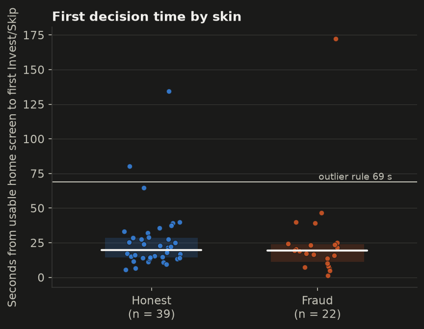

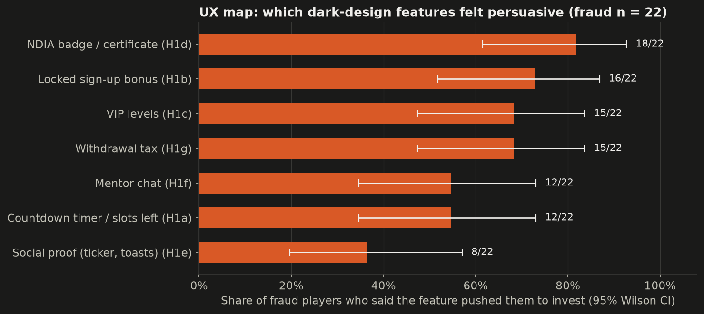

| Role | Outcome | Prediction | Test | Statistic | p | Holm p | Effect [95% CI] | n | Direction |
| --- | --- | --- | --- | --- | --- | --- | --- | --- | --- |
| Primary | first decision time | fraud < honest | Mann-Whitney U (two-sided) | U = 383.00 | 0.494 | 1.000 | δ = -0.11 [-0.40, 0.19] | fraud 22, honest 39 | as predicted |
| Secondary | said the timer pushed them | share of fraud players saying the timer pushed them | Share with Wilson 95% CI (no test) | – | – | – | share = 55% [35%, 73%] | players 22 | – |
| Robustness | first decision time | fraud < honest (outliers removed) | Mann-Whitney U (two-sided) | U = 344.00 | 0.477 | – | δ = -0.11 [-0.43, 0.20] | fraud 21, honest 37 | as predicted |

**Verdict and what the data does NOT justify.**

- A non-significant result is not evidence of no effect: the 95% CI (-0.11 [-0.40, 0.19]) is wide enough to include both no effect and a sizeable effect. The data cannot decide between them at this sample size.
- Fraud players dropped out more (22/62 completed vs 39/62 honest), so the fraud finishers are a selected group; a skin difference among finishers is not a clean causal effect of the design.
- Even a faster fraud decision could come from any part of the fraud home screen (VIP pop-up, ticker, badge, look), not the timer alone. The feature card is a self-report.

**Robustness notes.**

- Holm-adjusted p for the primary test within the H1 family (H1, H1a/H1e, H1b, H1c, H1d, H1f): 1.000 (raw p = 0.494). Verdicts use the raw p-value as pre-registered.
- Decision-time outliers (> 68.9 s): 2 honest, 1 fraud. With them: δ = -0.11 [-0.40, 0.19], p = 0.494; without them: δ = -0.11 [-0.43, 0.20], p = 0.477. Same conclusion.

### H1b — Sign-up bonus locked until the first deposit

**Verdict: NOT SUPPORTED** — predicted direction but not significant (primary p = 1.000 ≥ 0.10; the secondary outcomes are descriptive shares without a test).

**What we claimed.** A sign-up bonus credited to the wallet but withdrawable only after a first deposit (endowment, reciprocity) raises the first-deposit rate.

**How the experiment tests it.** Players were randomly assigned to the fraud skin ("ZenTrade X") or the honest skin ("ZenTrade"). Both skins run the same scripted market, amounts, returns and payoffs (checked by an automated skin-parity test); only the presentation differs. So any difference between the two groups can only come from the design layer, not from different incentives. Both skins give the same ₹500 bonus; only the fraud skin locks it until the first deposit and says so. trap_hook = 1 when the round-1 stake is above 0.

**The maths.**

```text
trap_hook = 1[r1_amount > 0]

Fisher's exact test on the 2×2 table skin × trap_hook; OR = (a·d)/(b·c), Woolf CI
H0: OR = 1        H1: OR > 1
```

**Result.**

**Primary.** Invested in round 1 (hook): fraud 20/22 (91%) vs honest 34/39 (87%); OR = 1.47 [0.26, 8.30], p = 1.000 (Holm p = 1.000) — direction as predicted.

**Secondary.** Said the locked bonus pushed them: 16 of 22 (73%, 95% CI 52%–87%).

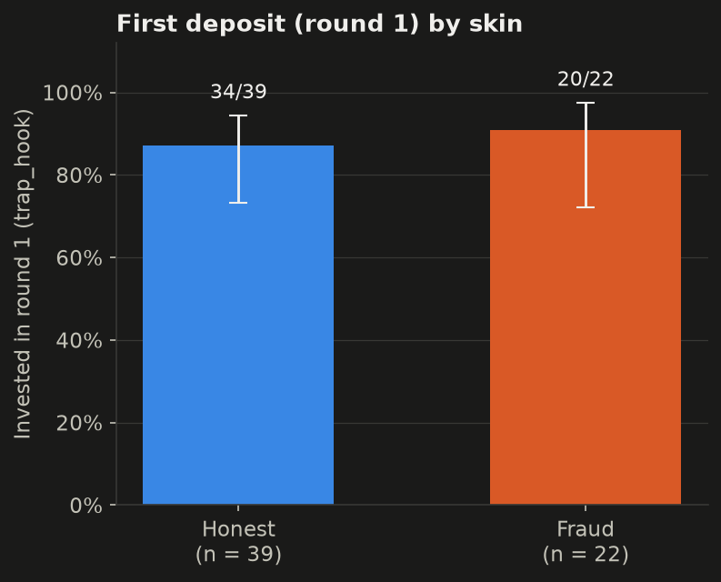

| Role | Outcome | Prediction | Test | Statistic | p | Holm p | Effect [95% CI] | n | Direction |
| --- | --- | --- | --- | --- | --- | --- | --- | --- | --- |
| Primary | invested in round 1 (hook) | fraud > honest | Fisher's exact test (two-sided) | OR = 1.47 | 1.000 | 1.000 | OR = 1.47 [0.26, 8.30] | fraud 22, honest 39 | as predicted |
| Secondary | said the locked bonus pushed them | share of fraud players saying the locked bonus pushed them | Share with Wilson 95% CI (no test) | – | – | – | share = 73% [52%, 87%] | players 22 | – |

**Verdict and what the data does NOT justify.**

- A non-significant result is not evidence of no effect: the 95% CI (1.47 [0.26, 8.30]) is wide enough to include both no effect and a sizeable effect. The data cannot decide between them at this sample size.
- Fraud players dropped out more (22/62 completed vs 39/62 honest), so the fraud finishers are a selected group; a skin difference among finishers is not a clean causal effect of the design.
- A higher hook rate in the fraud skin would still not isolate the locked bonus from the other fraud features.

**Robustness notes.**

- Holm-adjusted p for the primary test within the H1 family (H1, H1a/H1e, H1b, H1c, H1d, H1f): 1.000 (raw p = 1.000). Verdicts use the raw p-value as pre-registered.

### H1c — VIP levels

**Verdict: NOT SUPPORTED** — estimate points the opposite way and is not significant (p = 0.658): no evidence for the predicted effect.

**What we claimed.** VIP levels where bigger deposits unlock higher daily returns (goal gradient, status, sunk cost) lead to larger deposits to reach the next tier.

**How the experiment tests it.** Players were randomly assigned to the fraud skin ("ZenTrade X") or the honest skin ("ZenTrade"). Both skins run the same scripted market, amounts, returns and payoffs (checked by an automated skin-parity test); only the presentation differs. So any difference between the two groups can only come from the design layer, not from different incentives. The VIP level is computed the same way in both skins from total deposits, but only fraud players see the VIP pop-up, bar, nudges and level-up banner. The promised higher returns always start "next cycle", so payoffs stay identical.

**The maths.**

```text
vip_level = 0 if total < 1,000; 1 if < 5,000; 2 if < 10,000; else 3
vip_upgrade = 1[total_deposited ≥ 5,000]

Fisher's exact test (skin × vip_upgrade): H0: OR = 1, H1: OR > 1
Mann-Whitney U on vip_level: H0: δ = 0, H1: δ > 0
```

**Result.**

**Primary.** Deposited ≥ ₹5,000 (VIP 2+): fraud 19/22 (86%) vs honest 36/39 (92%); OR = 0.53 [0.10, 2.87], p = 0.658 (Holm p = 1.000) — direction opposite.

**Secondary.** VIP level (0–3): fraud median 3.00 (mean 2.64, n = 22) vs honest median 3.00 (mean 2.41, n = 39); δ = 0.21 [-0.05, 0.48], p = 0.113 — direction as predicted. Said the VIP levels pushed them: 15 of 22 (68%, 95% CI 47%–84%).

Within fraud (descriptive): 4 of 22 players tapped an after-round VIP nudge (mean 0.32 taps); 22 of 22 saw at least one level-up (mean 2.00).

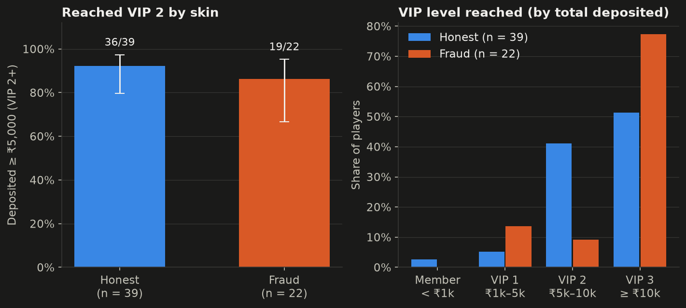

| Role | Outcome | Prediction | Test | Statistic | p | Holm p | Effect [95% CI] | n | Direction |
| --- | --- | --- | --- | --- | --- | --- | --- | --- | --- |
| Primary | deposited ≥ ₹5,000 (VIP 2+) | fraud > honest | Fisher's exact test (two-sided) | OR = 0.53 | 0.658 | 1.000 | OR = 0.53 [0.10, 2.87] | fraud 22, honest 39 | opposite |
| Secondary | VIP level (0–3) | fraud > honest | Mann-Whitney U (two-sided) | U = 521.00 | 0.113 | – | δ = 0.21 [-0.05, 0.48] | fraud 22, honest 39 | as predicted |
| Secondary | said the VIP levels pushed them | share of fraud players saying the VIP levels pushed them | Share with Wilson 95% CI (no test) | – | – | – | share = 68% [47%, 84%] | players 22 | – |

**Verdict and what the data does NOT justify.**

- A non-significant result is not evidence of no effect: the 95% CI (0.53 [0.10, 2.87]) is wide enough to include both no effect and a sizeable effect. The data cannot decide between them at this sample size.
- Fraud players dropped out more (22/62 completed vs 39/62 honest), so the fraud finishers are a selected group; a skin difference among finishers is not a clean causal effect of the design.
- VIP level is a function of total deposits, so it is not independent of H1's primary outcome. The VIP layer is bundled with the other fraud features.

**Robustness notes.**

- Holm-adjusted p for the primary test within the H1 family (H1, H1a/H1e, H1b, H1c, H1d, H1f): 1.000 (raw p = 0.658). Verdicts use the raw p-value as pre-registered.

### H1d — Fake regulatory credentials

**Verdict: SUPPORTED** — primary in the predicted direction, p = 0.002 < 0.05.

**What we claimed.** Fake regulatory credentials (badges, certificates; the fictional regulator "NDIA") raise trust and lead to fewer verification checks.

**How the experiment tests it.** Players were randomly assigned to the fraud skin ("ZenTrade X") or the honest skin ("ZenTrade"). Both skins run the same scripted market, amounts, returns and payoffs (checked by an automated skin-parity test); only the presentation differs. So any difference between the two groups can only come from the design layer, not from different incentives. Every verification opportunity (T&C, plan/deal/pool details, badge, About) is logged. The fraud skin shows a badge with a certificate; the honest skin has an About page saying the app is not registered.

**The maths.**

```text
verify_any = 1[verify_count > 0]

Fisher's exact test (skin × verify_any): H0: OR = 1, H1: OR < 1
Mann-Whitney U on verify_count: H0: δ = 0, H1: δ < 0
```

**Result.**

**Primary.** Verified anything: fraud 1/22 (5%) vs honest 16/39 (41%); OR = 0.07 [0.01, 0.56], p = 0.002 (Holm p = 0.014) — direction as predicted.

**Secondary.** Verification opens: fraud median 0.00 (mean 0.09, n = 22) vs honest median 0.00 (mean 1.18, n = 39); δ = -0.37 [-0.54, -0.20], p = 0.003 — direction as predicted. Said the NDIA badge pushed them: 18 of 22 (82%, 95% CI 61%–93%).

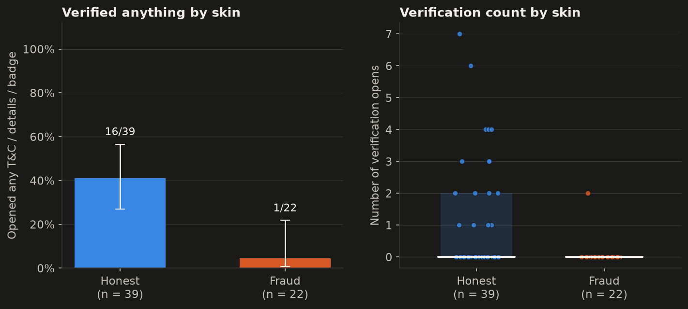

| Role | Outcome | Prediction | Test | Statistic | p | Holm p | Effect [95% CI] | n | Direction |
| --- | --- | --- | --- | --- | --- | --- | --- | --- | --- |
| Primary | verified anything | fraud < honest | Fisher's exact test (two-sided) | OR = 0.07 | 0.002 | 0.014 | OR = 0.07 [0.01, 0.56] | fraud 22, honest 39 | as predicted |
| Secondary | verification opens | fraud < honest | Mann-Whitney U (two-sided) | U = 270.50 | 0.003 | – | δ = -0.37 [-0.54, -0.20] | fraud 22, honest 39 | as predicted |
| Secondary | said the NDIA badge pushed them | share of fraud players saying the NDIA badge pushed them | Share with Wilson 95% CI (no test) | – | – | – | share = 82% [61%, 93%] | players 22 | – |

**Verdict and what the data does NOT justify.**

- The result survives the Holm correction (Holm p = 0.014).
- Fraud players dropped out more (22/62 completed vs 39/62 honest), so the fraud finishers are a selected group; a skin difference among finishers is not a clean causal effect of the design.
- Opening the fraud badge counts as a verification click, so the badge itself creates something to check; the two skins do not offer identical things to verify.

**Robustness notes.**

- Holm-adjusted p for the primary test within the H1 family (H1, H1a/H1e, H1b, H1c, H1d, H1f): 0.014 (raw p = 0.002). Verdicts use the raw p-value as pre-registered.

### H1e — Social proof (ticker, testimonials)

**Verdict: NOT SUPPORTED** — predicted direction but not significant (primary p = 0.494 ≥ 0.10; the secondary outcomes are descriptive shares without a test).

**What we claimed.** A live withdrawal ticker and screenshot testimonials (social proof, FOMO) lead to more investing and faster decisions.

**How the experiment tests it.** Players were randomly assigned to the fraud skin ("ZenTrade X") or the honest skin ("ZenTrade"). Both skins run the same scripted market, amounts, returns and payoffs (checked by an automated skin-parity test); only the presentation differs. So any difference between the two groups can only come from the design layer, not from different incentives. The ticker, winner toasts and testimonials run on the fraud home screen, so the shared linked behaviour is again the first decision time (the same test as H1a).

**The maths.**

```text
Same test as H1a: Mann-Whitney U on decision_time_first_invest, H0: δ = 0, H1: δ < 0
Feature card: share with Wilson 95% CI
```

**Result.**

**Primary.** First decision time: fraud median 19.2 s (mean 26.2 s, n = 22) vs honest median 19.8 s (mean 26.2 s, n = 39); δ = -0.11 [-0.40, 0.19], p = 0.494 (Holm p = 1.000) — direction as predicted.

**Secondary.** Said the social proof pushed them: 8 of 22 (36%, 95% CI 20%–57%).


| Role | Outcome | Prediction | Test | Statistic | p | Holm p | Effect [95% CI] | n | Direction |
| --- | --- | --- | --- | --- | --- | --- | --- | --- | --- |
| Primary | first decision time | fraud < honest | Mann-Whitney U (two-sided) | U = 383.00 | 0.494 | 1.000 | δ = -0.11 [-0.40, 0.19] | fraud 22, honest 39 | as predicted |
| Secondary | said the social proof pushed them | share of fraud players saying social proof pushed them | Share with Wilson 95% CI (no test) | – | – | – | share = 36% [20%, 57%] | players 22 | – |
| Robustness | first decision time | fraud < honest (outliers removed) | Mann-Whitney U (two-sided) | U = 344.00 | 0.477 | – | δ = -0.11 [-0.43, 0.20] | fraud 21, honest 37 | as predicted |

**Verdict and what the data does NOT justify.**

- A non-significant result is not evidence of no effect: the 95% CI (-0.11 [-0.40, 0.19]) is wide enough to include both no effect and a sizeable effect. The data cannot decide between them at this sample size.
- Fraud players dropped out more (22/62 completed vs 39/62 honest), so the fraud finishers are a selected group; a skin difference among finishers is not a clean causal effect of the design.
- H1a and H1e share one test, so the data cannot separate social proof from the timer.

**Robustness notes.**

- Holm-adjusted p for the primary test within the H1 family (H1, H1a/H1e, H1b, H1c, H1d, H1f): 1.000 (raw p = 0.494). Verdicts use the raw p-value as pre-registered.
- Decision-time outliers (> 68.9 s): 2 honest, 1 fraud. With them: δ = -0.11 [-0.40, 0.19], p = 0.494; without them: δ = -0.11 [-0.43, 0.20], p = 0.477. Same conclusion.

### H1f — Mentor chat nudging deposits

**Verdict: NOT SUPPORTED** — predicted direction but not significant (primary p = 0.148 ≥ 0.10; the secondary outcomes are descriptive shares without a test).

**What we claimed.** A "customer service" or mentor chat that nudges users to deposit (authority, social trust) raises the deposit after the nudge.

**How the experiment tests it.** Players were randomly assigned to the fraud skin ("ZenTrade X") or the honest skin ("ZenTrade"). Both skins run the same scripted market, amounts, returns and payoffs (checked by an automated skin-parity test); only the presentation differs. So any difference between the two groups can only come from the design layer, not from different incentives. The chat appears only in the fraud skin, right before round 4; the honest skin has no chat screen, so the round-4 stake is the cross-skin proxy. Within fraud, chat_deposit = any deposit within 60 s of the chat appearing.

**The maths.**

```text
chat_deposit = 1[any deposit with 0 ≤ since_chat_ms ≤ 60,000]   (fraud only)

Mann-Whitney U on r4_amount: H0: δ = 0, H1: δ > 0
Within fraud: share with Wilson 95% CI
```

**Result.**

**Primary.** Round-4 stake: fraud median ₹4,250 (mean ₹4,091, n = 22) vs honest median ₹2,000 (mean ₹2,749, n = 39); δ = 0.22 [-0.08, 0.51], p = 0.148 (Holm p = 0.591) — direction as predicted.

**Secondary.** Deposit within 60 s of the chat: 21 of 22 (95%, 95% CI 78%–99%). Said the mentor chat pushed them: 12 of 22 (55%, 95% CI 35%–73%).

10 of 22 fraud players opened the mentor chat.

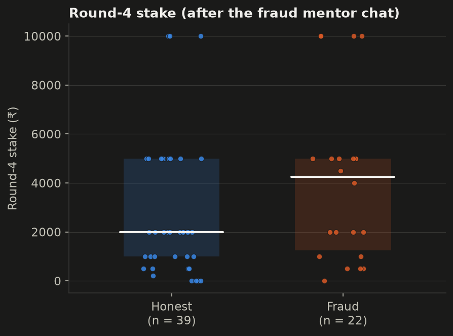

| Role | Outcome | Prediction | Test | Statistic | p | Holm p | Effect [95% CI] | n | Direction |
| --- | --- | --- | --- | --- | --- | --- | --- | --- | --- |
| Primary | round-4 stake | fraud > honest | Mann-Whitney U (two-sided) | U = 524.00 | 0.148 | 0.591 | δ = 0.22 [-0.08, 0.51] | fraud 22, honest 39 | as predicted |
| Secondary | deposit within 60 s of the chat | share of fraud players depositing within 60 s of the chat | Share with Wilson 95% CI (no test) | – | – | – | share = 95% [78%, 99%] | players 22 | – |
| Secondary | said the mentor chat pushed them | share of fraud players saying the mentor chat pushed them | Share with Wilson 95% CI (no test) | – | – | – | share = 55% [35%, 73%] | players 22 | – |

**Verdict and what the data does NOT justify.**

- A non-significant result is not evidence of no effect: the 95% CI (0.22 [-0.08, 0.51]) is wide enough to include both no effect and a sizeable effect. The data cannot decide between them at this sample size.
- Fraud players dropped out more (22/62 completed vs 39/62 honest), so the fraud finishers are a selected group; a skin difference among finishers is not a clean causal effect of the design.
- Round 4 differs between skins in more than the chat (all fraud features stay on), so even a higher fraud round-4 stake would not isolate the chat. chat_deposit has no honest baseline, so its rate cannot be read as an effect of the chat.

**Robustness notes.**

- Holm-adjusted p for the primary test within the H1 family (H1, H1a/H1e, H1b, H1c, H1d, H1f): 0.591 (raw p = 0.148). Verdicts use the raw p-value as pre-registered.

### H1g — Withdrawal blocked by a "tax"

**Verdict: NOT TESTABLE** — no comparison group exists in the design; the rate is descriptive.

**What we claimed.** A withdrawal blocked by a "tax", fee or freeze until an extra payment (endowment, loss aversion, sunk cost) makes people pay to unlock.

**How the experiment tests it.** Only the fraud skin blocks the final withdrawal with a 10% "processing tax"; the honest skin pays out instantly. There is no comparison group, so the share who paid is a description of willingness to pay, not a test of whether the tax causes paying.

**The maths.**

```text
tax_paid rate = k / n among fraud players shown the tax, Wilson 95% CI
No H0 / H1: no comparison group exists
```

**Result.**

**Primary.** Paid the withdrawal tax: 14 of 22 (64%, 95% CI 43%–80%).

**Secondary.** Said the withdrawal tax pushed them: 15 of 22 (68%, 95% CI 47%–84%).

22 of 22 fraud completers reached the tax block.

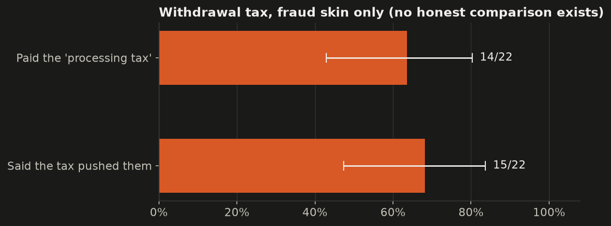

| Role | Outcome | Prediction | Test | Statistic | p | Holm p | Effect [95% CI] | n | Direction |
| --- | --- | --- | --- | --- | --- | --- | --- | --- | --- |
| Primary | paid the withdrawal tax | share of fraud players shown the tax who paid it | Share with Wilson 95% CI (no test) | – | – | – | share = 64% [43%, 80%] | players 22 | – |
| Secondary | said the withdrawal tax pushed them | share of fraud players saying the tax pushed them | Share with Wilson 95% CI (no test) | – | – | – | share = 68% [47%, 84%] | players 22 | – |

**Verdict and what the data does NOT justify.**

- Without a control condition the data cannot say the tax design caused payment, or how many would pay under a neutral fee message. Paying cost virtual money only.

### H1h — UX map: which features felt persuasive

**Verdict: DESCRIPTIVE** — shares only, no hypothesis test.

**What we claimed.** Each sub-hypothesis is also tested through the fraud-only feature swipe cards: the share of players saying each feature pushed them to invest (the design-vulnerability map).

**How the experiment tests it.** After the game (before the reveal), fraud players saw a mini re-render of each feature and answered "Did this push you to invest?" (yes/no). Honest players never saw the features, so there is no comparison.

**The maths.**

```text
p̂_feature = (# fraud players answering yes) / (# fraud players answering), Wilson 95% CI
```

**Result.**

Ranked: NDIA badge / certificate 18/22 (82%); Locked sign-up bonus 16/22 (73%); VIP levels 15/22 (68%); Withdrawal tax 15/22 (68%); Countdown timer / slots left 12/22 (55%); Mentor chat 12/22 (55%); Social proof (ticker, toasts) 8/22 (36%).

On average fraud players said 4.4 of 7 features pushed them (median 4.5); 1 said none did.


**Verdict and what the data does NOT justify.**

- Self-reports of being pushed are not the same as being pushed: players may not notice or admit influence, and the wording invites agreement.

### H2 — An early small win increases later investment

**Verdict: NOT SUPPORTED** — estimate points the opposite way and is not significant (p = 0.551): no evidence for the predicted effect.

**What we claimed.** Participants who see a small profit after their first investment invest more in the next round than those who see no gain.

**How the experiment tests it.** Round 1's result was randomized (+8% small win vs 0% flat) independently of skin; everything else in rounds 1–2 is identical. Comparing the next stake between the two groups isolates the effect of the early win.

**The maths.**

```text
escalation_ratio = r2_amount / r1_amount   (defined only if r1_amount > 0)

Mann-Whitney U: H0: δ = 0, H1: δ > 0  (δ = P(E_win > E_flat) − P(E_win < E_flat))
```

**Result.**

7 players skipped round 1 and have no escalation ratio (small win 2, flat 5); they stay in the round-2 stake comparison.

**Primary.** Escalation ratio (r2 ÷ r1): small win median 1.00 (mean 2.08, n = 27) vs flat median 1.00 (mean 2.40, n = 27); δ = -0.09 [-0.39, 0.22], p = 0.551 (Holm p = 1.000) — direction opposite.

**Secondary.** Round-2 stake: small win median ₹1,000 (mean ₹2,338, n = 29) vs flat median ₹1,500 (mean ₹2,750, n = 32); δ = -0.15 [-0.43, 0.14], p = 0.327 — direction opposite.

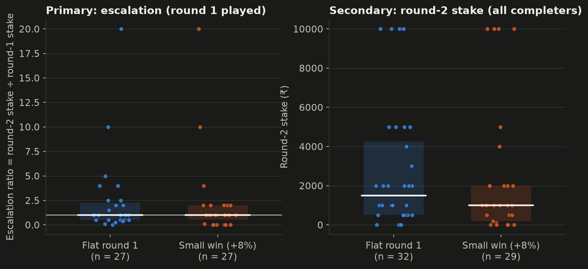

| Role | Outcome | Prediction | Test | Statistic | p | Holm p | Effect [95% CI] | n | Direction |
| --- | --- | --- | --- | --- | --- | --- | --- | --- | --- |
| Primary | escalation ratio (r2 ÷ r1) | small win > flat | Mann-Whitney U (two-sided) | U = 330.50 | 0.551 | 1.000 | δ = -0.09 [-0.39, 0.22] | small win 27, flat 27 | opposite |
| Secondary | round-2 stake | small win > flat | Mann-Whitney U (two-sided) | U = 396.50 | 0.327 | – | δ = -0.15 [-0.43, 0.14] | small win 29, flat 32 | opposite |
| Robustness | escalation ratio (r2 ÷ r1) | small_win > flat (ITT: everyone who played round 2 with r1 > 0) | Mann-Whitney U (two-sided) | U = 592.00 | 0.514 | – | δ = -0.09 [-0.33, 0.18] | small_win 36, flat 36 | opposite |
| Robustness | round-2 stake | small_win > flat (ITT: everyone who played round 2) | Mann-Whitney U (two-sided) | U = 700.50 | 0.258 | – | δ = -0.14 [-0.39, 0.11] | small_win 39, flat 42 | opposite |

**Verdict and what the data does NOT justify.**

- A non-significant result is not evidence of no effect: the 95% CI (-0.09 [-0.39, 0.22]) is wide enough to include both no effect and a sizeable effect. The data cannot decide between them at this sample size.
- The early win is small (+8% of a virtual stake) and shown once; a null result does not rule out larger or repeated early wins mattering in real apps.

**Robustness notes.**

- Holm-adjusted p for the primary test within the H2–H7 primary tests: 1.000 (raw p = 0.551). Verdicts use the raw p-value as pre-registered.
- Intention-to-treat rerun on everyone who reached the home screen (honest 57, fraud 54; 50 non-completers added):
  - escalation ratio (r2 ÷ r1): completers δ = -0.09 [-0.39, 0.22], p = 0.551; ITT δ = -0.09 [-0.33, 0.18], p = 0.514 → same conclusion.
  - round-2 stake: completers δ = -0.15 [-0.43, 0.14], p = 0.327; ITT δ = -0.14 [-0.39, 0.11], p = 0.258 → same conclusion.

### H3 — People trust faster when stakes are small

**Verdict: NOT SUPPORTED** — estimate points the opposite way and is not significant (p = 0.336): no evidence for the predicted effect.

**What we claimed.** Willingness to invest without verifying is highest at small amounts and falls as the amount rises.

**How the experiment tests it.** Within-subject: every player saw all three flash deals (₹500, ₹3,000, ₹8,000) on one screen, in random card order, with the same +5% return and the same "View details" button. Each player is their own control, so differences across sizes come from the stake, not from who the player is. Card position is checked separately.

**The maths.**

```text
details_s = 1[details opened before investing / Continue] for s ∈ {500, 3000, 8000}

Cochran's Q = (k − 1)[k Σ C_j² − N²] / (k N − Σ R_i²),  k = 3,  df = 2
H0: P(details_500) = P(details_3000) = P(details_8000)
H1: the shares differ, with the lowest share at ₹500
Effect: η²_Q = Q / (n(k − 1));  pairwise exact McNemar (Holm);  Friedman χ²_F on times, Kendall's W
```

**Result.**

Details opened by size: ₹500 7/61 (11%), ₹3,000 9/61 (15%), ₹8,000 5/61 (8%). Invested by size: ₹500 30/61 (49%), ₹3,000 26/61 (43%), ₹8,000 20/61 (33%).

**Primary.** Opened deal details: η²_Q = 0.02 [0.00, 0.09], p = 0.336 (Holm p = 1.000) — direction opposite.

**Secondary.** Invested in the deal: η²_Q = 0.04 [0.00, 0.15], p = 0.079 — direction as predicted. Deal decision time: W = 0.00 [0.00, 0.07], p = 0.923 — direction opposite. Details share lower at ₹500 than at ₹3,000: diff = -0.03 [-0.11, 0.05], p = 0.727 (Holm p = 1.000) — direction as predicted. Details share lower at ₹500 than at ₹8,000: diff = 0.03 [-0.05, 0.11], p = 0.727 (Holm p = 1.000) — direction opposite. Details share lower at ₹3,000 than at ₹8,000: diff = 0.07 [0.00, 0.15], p = 0.219 (Holm p = 0.656) — direction opposite.

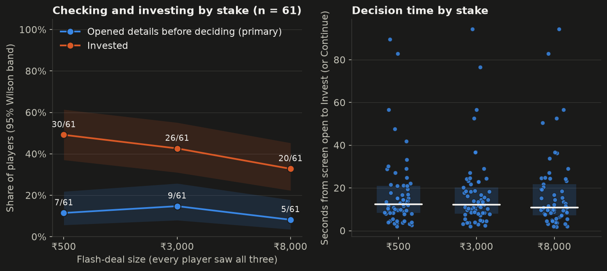

| Role | Outcome | Prediction | Test | Statistic | p | Holm p | Effect [95% CI] | n | Direction |
| --- | --- | --- | --- | --- | --- | --- | --- | --- | --- |
| Primary | opened deal details | details opened least at ₹500 (share lowest at ₹500) | Cochran's Q (df = 2) | Q = 2.18 | 0.336 | 1.000 | η²_Q = 0.02 [0.00, 0.09] | players 61 | opposite |
| Secondary | invested in the deal | investing most at ₹500 (share highest at ₹500) | Cochran's Q (df = 2) | Q = 5.07 | 0.079 | – | η²_Q = 0.04 [0.00, 0.15] | players 61 | as predicted |
| Secondary | deal decision time | shortest time at ₹500 | Friedman test (df = 2) | χ²_F = 0.16 | 0.923 | – | W = 0.00 [0.00, 0.07] | players 61 | opposite |
| Secondary | opened deal details | details share lower at ₹500 than at ₹3,000 | Exact McNemar test (pairwise, Holm within H3) | discordant b / c = 3 / 5 | 0.727 | 1.000 | diff = -0.03 [-0.11, 0.05] | players 61 | as predicted |
| Secondary | opened deal details | details share lower at ₹500 than at ₹8,000 | Exact McNemar test (pairwise, Holm within H3) | discordant b / c = 5 / 3 | 0.727 | 1.000 | diff = 0.03 [-0.05, 0.11] | players 61 | opposite |
| Secondary | opened deal details | details share lower at ₹3,000 than at ₹8,000 | Exact McNemar test (pairwise, Holm within H3) | discordant b / c = 5 / 1 | 0.219 | 0.656 | diff = 0.07 [0.00, 0.15] | players 61 | opposite |
| Check | opened deal details | (check) no card-position effect | Cochran's Q over card position (df = 2) | Q = 2.18 | 0.336 | – | η²_Q = 0.02 | players 61 | – |
| Check | invested in the deal | (check) no card-position effect | Cochran's Q over card position (df = 2) | Q = 3.27 | 0.195 | – | η²_Q = 0.03 | players 61 | – |

**Verdict and what the data does NOT justify.**

- A non-significant result is not evidence of no effect: the 95% CI (0.02 [0.00, 0.09]) is wide enough to include both no effect and a sizeable effect. The data cannot decide between them at this sample size.
- The deals were all affordable and all paid +5%, so the test is about checking habits, not about risk; the ₹ amounts were virtual.

**Robustness notes.**

- Holm-adjusted p for the primary test within the H2–H7 primary tests: 1.000 (raw p = 0.336). Verdicts use the raw p-value as pre-registered.
- Card-position check (details): position 1 11%, position 2 8%, position 3 15%; Cochran's Q p = 0.336.
- Card-position check (invest): position 1 34%, position 2 48%, position 3 43%; Cochran's Q p = 0.195.
- Pairwise McNemar on details (Holm within H3): ₹500 vs ₹3000: diff -0.03 [-0.11, 0.05], p = 0.727, Holm p = 1.000; ₹500 vs ₹8000: diff 0.03 [-0.05, 0.11], p = 0.727, Holm p = 1.000; ₹3000 vs ₹8000: diff 0.07 [0.00, 0.15], p = 0.219, Holm p = 0.656.

### H4 — Loss aversion drives loss chasing

**Verdict: NOT SUPPORTED** — estimate points the opposite way and is not significant (p = 0.084): no evidence for the predicted effect.

**What we claimed.** After a scripted loss, participants with higher loss aversion are more likely to add money to recover their balance.

**How the experiment tests it.** Loss aversion was measured behaviourally by two 50/50 spins (lose ₹100 / win ₹150 or ₹250, accept or skip) before the crash; the crash itself (−40%) is identical for everyone. The top-up decision after the crash is then related to the measured group, controlling for skin and investing experience. This is a correlational test inside the experiment (loss aversion was measured, not assigned).

**The maths.**

```text
loss_aversion_group: 1 = accepted both (λ ≤ 1.5), 2 = rejected 150, accepted 250 (1.5 < λ ≤ 2.5),
                     3 = rejected both (λ > 2.5)   [accept a 50/50 (−100, +X) bet iff X ≥ λ·100]

logit P(topup = 1) = β0 + β1·LA_group + β2·fraud + β3·exp_investing
H0: β1 = 0        H1: β1 > 0  (OR = e^β1 > 1)
```

**Result.**

Loss-aversion groups among consistent players: Low (1): 39, Typical (2): 10, High (3): 9; 3 inconsistent players excluded. The largest group holds 67% of players, so the test is not marked low-power (threshold 70%).

**Primary.** Topped up after the crash: OR = 0.51 [0.24, 1.09], p = 0.084 (Holm p = 0.503) — direction opposite.

**Secondary.** Top-up amount — ₹ per loss-aversion group step: b = -287.77 [-589.13, 13.59], p = 0.061 — direction opposite. Top-up amount: ρ = -0.20 [-0.44, 0.05], p = 0.135 — direction opposite.

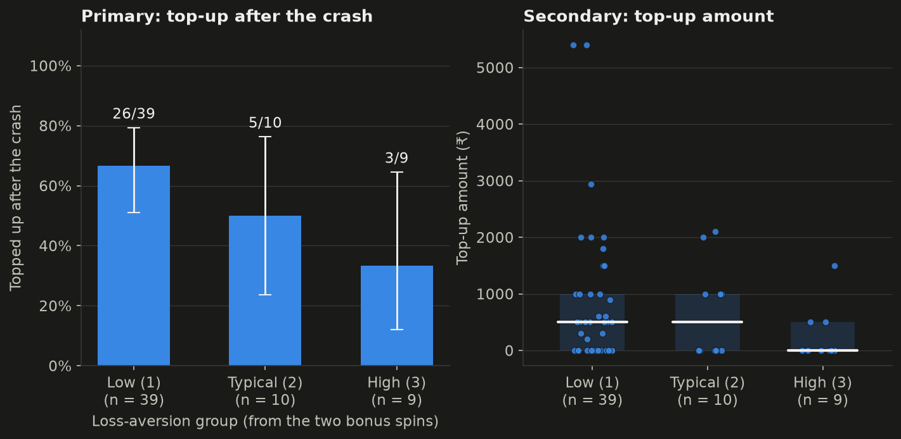

| Role | Outcome | Prediction | Test | Statistic | p | Holm p | Effect [95% CI] | n | Direction |
| --- | --- | --- | --- | --- | --- | --- | --- | --- | --- |
| Primary | topped up after the crash | higher loss-aversion group → more likely to top up (OR > 1) | Logistic regression: crash_topup ~ loss_aversion_group + fraud + exp_investing | z = -1.73 | 0.084 | 0.503 | OR = 0.51 [0.24, 1.09] | players 58 | opposite |
| Secondary | top-up amount | coefficient of loss_aversion_group > 0 | OLS (HC3): crash_topup_amount ~ loss_aversion_group + fraud + exp_investing | t = -1.87 | 0.061 | – | b = -287.77 [-589.13, 13.59] | players 58 | opposite |
| Secondary | top-up amount | ρ(loss_aversion_group, crash_topup_amount) > 0 | Spearman correlation | ρ = -0.20 | 0.135 | – | ρ = -0.20 [-0.44, 0.05] | players 58 | opposite |
| Check | loss-aversion group | (check) no spin-order effect on the loss-aversion group | Mann-Whitney U (two-sided) | U = 344.50 | 0.270 | – | δ = -0.14 [-0.38, 0.11] | 150;250 23, 250;150 35 | – |

**Verdict and what the data does NOT justify.**

- The primary estimate points the **opposite** way (OR = 0.51 [0.24, 1.09], p = 0.084). This was not predicted and is not significant at 0.05, so it is not a confirmed reverse effect either; it is a pattern to re-test.
- Loss aversion was not randomized, so even a significant link would be an association; the two-spin measure is coarse (three groups).

**Robustness notes.**

- Holm-adjusted p for the primary test within the H2–H7 primary tests: 0.503 (raw p = 0.084). Verdicts use the raw p-value as pre-registered.
- Spin-order check: loss-aversion group by spin order, δ = -0.14 [-0.38, 0.11], p = 0.270 (a check, not a hypothesis test).

### H5 — A friend's referral lowers verification

**Verdict: NOT SUPPORTED** — estimate points the opposite way and is not significant (p = 0.416): no evidence for the predicted effect.

**What we claimed.** The same app is joined more readily, and checked less, when a friend refers it than when it appears as an ad.

**How the experiment tests it.** The same ₹2,000 pool (whose details reveal it pays from new members) was offered either as a WhatsApp message from a college friend or as a sponsored ad, randomized independently of skin. Only the source differs.

**The maths.**

```text
Fisher's exact test (source × pool_join): H0: OR = 1, H1: OR > 1 (friend vs ad)
pool_details: H1: OR < 1;  pool_time: Mann-Whitney U, H1: δ < 0
Moderator (exploratory): logit P(join) = β0 + β1·friend + β2·fomo + β3·friend·fomo
```

**Result.**

**Primary.** Joined the pool: friend 8/30 (27%) vs ad 12/31 (39%); OR = 0.58 [0.19, 1.70], p = 0.416 (Holm p = 1.000) — direction opposite.

**Secondary.** Opened pool details: friend 3/30 (10%) vs ad 5/31 (16%); OR = 0.58 [0.13, 2.67], p = 0.707 — direction as predicted. Pool decision time: friend median 6.5 s (mean 7.8 s, n = 30) vs ad median 5.1 s (mean 7.4 s, n = 31); δ = 0.07 [-0.23, 0.36], p = 0.650 — direction opposite.

**Exploratory.** Joined the pool: OR = 0.51 [0.18, 1.40], p = 0.190 — direction opposite.

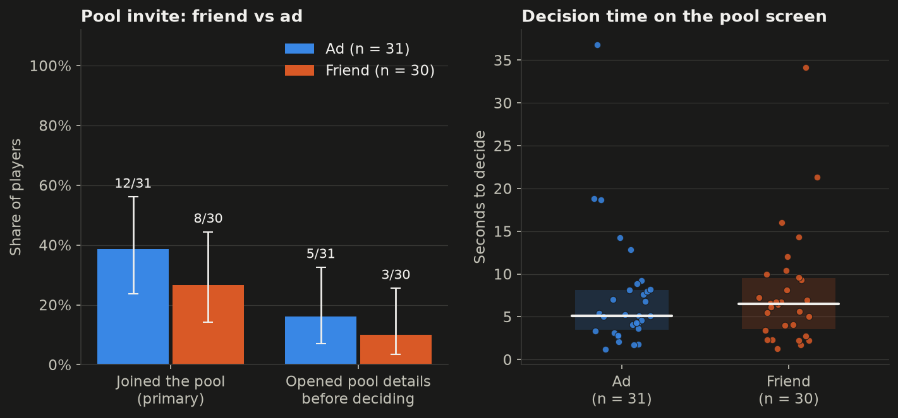

| Role | Outcome | Prediction | Test | Statistic | p | Holm p | Effect [95% CI] | n | Direction |
| --- | --- | --- | --- | --- | --- | --- | --- | --- | --- |
| Primary | joined the pool | friend > ad | Fisher's exact test (two-sided) | OR = 0.58 | 0.416 | 1.000 | OR = 0.58 [0.19, 1.70] | friend 30, ad 31 | opposite |
| Secondary | opened pool details | friend < ad | Fisher's exact test (two-sided) | OR = 0.58 | 0.707 | – | OR = 0.58 [0.13, 2.67] | friend 30, ad 31 | as predicted |
| Secondary | pool decision time | friend < ad | Mann-Whitney U (two-sided) | U = 497.00 | 0.650 | – | δ = 0.07 [-0.23, 0.36] | friend 30, ad 31 | opposite |
| Exploratory | joined the pool | friend effect larger for higher FOMO (interaction OR > 1) | Logistic regression: pool_join ~ friend × fomo_score | z = -1.31 | 0.190 | – | OR = 0.51 [0.18, 1.40] | players 61 | opposite |

**Verdict and what the data does NOT justify.**

- A non-significant result is not evidence of no effect: the 95% CI (0.58 [0.19, 1.70]) is wide enough to include both no effect and a sizeable effect. The data cannot decide between them at this sample size.
- The "friend" was a fictional character in a game; a real friend's referral carries far more trust, so the lab manipulation is weak by design.

**Robustness notes.**

- Holm-adjusted p for the primary test within the H2–H7 primary tests: 1.000 (raw p = 0.416). Verdicts use the raw p-value as pre-registered.

### H6 — A small successful withdrawal builds trust

**Verdict: NOT SUPPORTED** — estimate points the opposite way and is not significant (p = 0.542): no evidence for the predicted effect.

**What we claimed.** Participants allowed one small withdrawal deposit more afterwards than those not offered a withdrawal.

**How the experiment tests it.** Whether a ₹500 test withdrawal was offered was randomized independently of skin. Everyone then saw the same offer to deposit up to ₹5,000. The analysis is intention-to-treat on the offer.

**The maths.**

```text
Mann-Whitney U on post_withdrawal_deposit (allowed vs not offered)
H0: δ = 0        H1: δ > 0
```

**Result.**

**Primary.** Deposit after the withdrawal stage: allowed median ₹500 (mean ₹1,652, n = 33) vs not offered median ₹1,000 (mean ₹1,589, n = 28); δ = -0.09 [-0.36, 0.21], p = 0.542 (Holm p = 1.000) — direction opposite.

**Secondary.** Trust rating (1–7): allowed median 3.00 (mean 3.27, n = 33) vs not offered median 3.00 (mean 3.32, n = 28); δ = -0.01 [-0.30, 0.28], p = 0.947 — direction opposite.

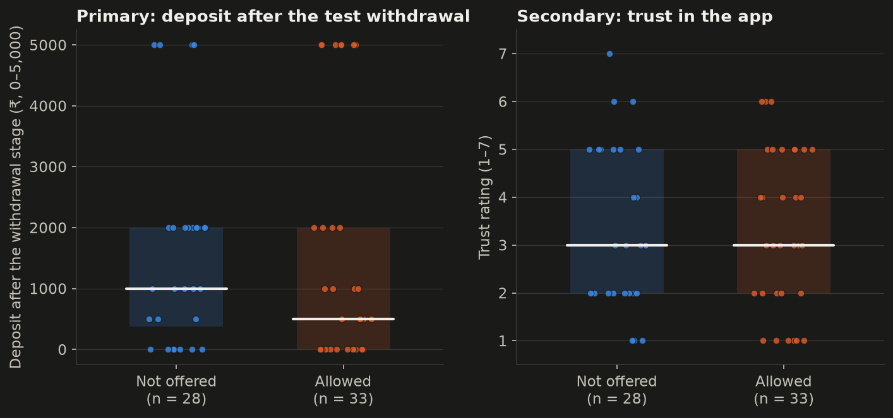

| Role | Outcome | Prediction | Test | Statistic | p | Holm p | Effect [95% CI] | n | Direction |
| --- | --- | --- | --- | --- | --- | --- | --- | --- | --- |
| Primary | deposit after the withdrawal stage | allowed > not offered | Mann-Whitney U (two-sided) | U = 420.50 | 0.542 | 1.000 | δ = -0.09 [-0.36, 0.21] | allowed 33, not offered 28 | opposite |
| Secondary | trust rating (1–7) | allowed > not offered | Mann-Whitney U (two-sided) | U = 457.00 | 0.947 | – | δ = -0.01 [-0.30, 0.28] | allowed 33, not offered 28 | opposite |
| Descriptive | took the test withdrawal | take-up of the ₹500 test withdrawal among those offered | Share with Wilson 95% CI (no test) | – | – | – | share = 82% [66%, 91%] | players 33 | – |

**Verdict and what the data does NOT justify.**

- A non-significant result is not evidence of no effect: the 95% CI (-0.09 [-0.36, 0.21]) is wide enough to include both no effect and a sizeable effect. The data cannot decide between them at this sample size.
- Trust was rated once at the end, after many later events, so it is a noisy measure of trust right after the withdrawal.

**Robustness notes.**

- Holm-adjusted p for the primary test within the H2–H7 primary tests: 1.000 (raw p = 0.542). Verdicts use the raw p-value as pre-registered.

### H7 — App profits are treated as house money

**Verdict: NOT SUPPORTED** — estimate points the opposite way and is not significant (p = 0.714): no evidence for the predicted effect.

**What we claimed.** Participants reinvest profits shown in the app more freely than an equal amount of their own fresh money.

**How the experiment tests it.** The Gold Plan offer (₹0–2,000, slider starting at ₹0, always affordable) was framed as coming from the Profit wallet or from the Main wallet, randomized independently of skin. Only the source of the money differs.

**The maths.**

```text
Mann-Whitney U on reinvest_amount (profit vs main): H0: δ = 0, H1: δ > 0
Fisher's exact test on reinvest_accept: H0: OR = 1, H1: OR > 1
```

**Result.**

**Primary.** Gold Plan amount: profit wallet median ₹1,000 (mean ₹972, n = 29) vs main wallet median ₹1,000 (mean ₹1,031, n = 32); δ = -0.05 [-0.34, 0.23], p = 0.714 (Holm p = 1.000) — direction opposite.

**Secondary.** Accepted the Gold Plan: profit wallet 23/29 (79%) vs main wallet 25/32 (78%); OR = 1.07 [0.31, 3.67], p = 1.000 — direction as predicted.

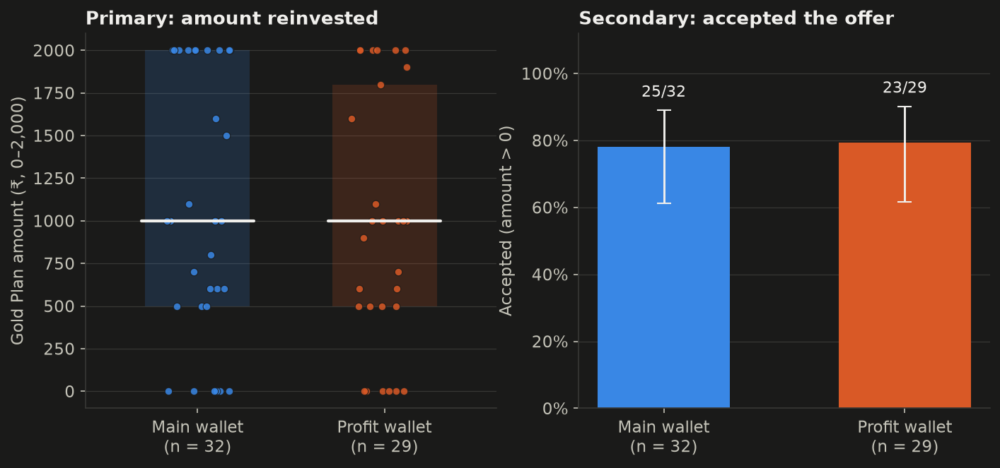

| Role | Outcome | Prediction | Test | Statistic | p | Holm p | Effect [95% CI] | n | Direction |
| --- | --- | --- | --- | --- | --- | --- | --- | --- | --- |
| Primary | Gold Plan amount | profit > main | Mann-Whitney U (two-sided) | U = 438.50 | 0.714 | 1.000 | δ = -0.05 [-0.34, 0.23] | profit wallet 29, main wallet 32 | opposite |
| Secondary | accepted the Gold Plan | profit > main | Fisher's exact test (two-sided) | OR = 1.07 | 1.000 | – | OR = 1.07 [0.31, 3.67] | profit wallet 29, main wallet 32 | as predicted |

**Verdict and what the data does NOT justify.**

- A non-significant result is not evidence of no effect: the 95% CI (-0.05 [-0.34, 0.23]) is wide enough to include both no effect and a sizeable effect. The data cannot decide between them at this sample size.
- Both wallets hold virtual money that players were given, so "own money" is only a framing; the house-money effect on real savings is not tested.

**Robustness notes.**

- Holm-adjusted p for the primary test within the H2–H7 primary tests: 1.000 (raw p = 0.714). Verdicts use the raw p-value as pre-registered.

### H8 — Financial literacy does not protect against fraud

**Verdict: PARTLY SUPPORTED** (app + dataset) — app: NOT SUPPORTED (overconfidence coefficient positive but p = 0.331 ≥ 0.10); dataset: SUPPORTED (overconfidence OR > 1 (p = 0.000); knowledge CI not entirely below 1).

**What we claimed.** Financial literacy does not reduce fraud susceptibility, while overconfidence (perceived minus actual literacy) increases it.

**How the experiment tests it.** App part: literacy (Big Three items, incentivized at ₹100 each) and self-rated money skill (asked before the game) are measured, and the number of shared traps fallen for is the susceptibility outcome. This is correlational. Dataset part: the same idea on real fraud in two US population surveys (NFCS 2024). The Investor Survey (investment fraud; primary model, fixed before fitting) measures an 11-item investing-knowledge quiz and self-rated investing knowledge; the State-by-State Survey (any financial fraud; large-sample check) measures the Big Three and self-rated financial knowledge. Survey-weighted logistic regressions relate knowledge and overconfidence to being targeted, losing money, wanting a 'guaranteed 25%' offer and checking a regulator. Measured, not assigned: these are associations, not causal effects.

**The maths.**

```text
overconfidence = z(self_rated_literacy) − z(literacy_score),  z = (x − x̄)/s over the 61 completers
trap_score_shared8 = β0 + β1·literacy + β2·overconfidence + β3·fin_edu + β4·fraud + β5·exp_investing + ε
H0: β2 = 0 (and β1 < 0: literacy protects)
H1: β2 > 0 and β1 ≥ 0     (HC3 robust SEs)
Note: with literacy in the model, β2 is the effect of a higher self-rating at equal literacy.

NFCS (dataset part), survey-weighted logistic regression, HC1 SEs, odds ratios per SD:
logit P(victim) = α + a·z(lit) + b·z(OC) + controls,   OC = z(self) − z(lit)
H0: e^b = 1 (and e^a < 1: literacy protects)     H1: e^b > 1 and the CI of e^a not entirely below 1

Reparameterization (same model, same fit):
a·z(lit) + b·(z(self) − z(lit)) = (a − b)·z(lit) + b·z(self)
→ with OC in the model, a = literacy at equal overconfidence;
  with z(self) in the model, (a − b) = literacy at equal self-rating.
  (OC is standardized here, so b above is our coefficient divided by SD(OC).)
```

**Result.**

Literacy score distribution: 0 correct: 1, 1 correct: 5, 2 correct: 15, 3 correct: 40. 66% score 3 of 3, so a **ceiling effect** is flagged: literacy hardly varies, which limits what the model can detect.

**Primary.** Trap score (shared 8) — traps per 1 unit of overconfidence: b = 0.24 [-0.25, 0.73], p = 0.331 — direction as predicted.

**Secondary.** Trap score (shared 8) — traps per extra correct literacy answer: b = -0.08 [-0.92, 0.75], p = 0.846 — direction as predicted.

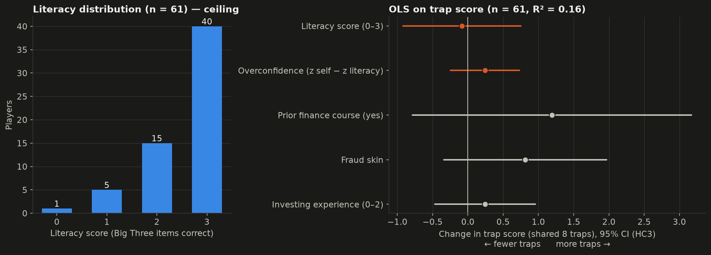

| Role | Outcome | Prediction | Test | Statistic | p | Holm p | Effect [95% CI] | n | Direction |
| --- | --- | --- | --- | --- | --- | --- | --- | --- | --- |
| Primary | trap score (shared 8) | overconfidence coefficient > 0 | OLS with HC3 SEs: trap_score_shared8 ~ literacy + overconfidence + fin. education + fraud + investing experience | t = 0.97 | 0.331 | – | b = 0.24 [-0.25, 0.73] | players 61 | as predicted |
| Secondary | trap score (shared 8) | literacy coefficient not negative (CI not entirely < 0) | OLS with HC3 SEs: trap_score_shared8 ~ literacy + overconfidence + fin. education + fraud + investing experience | t = -0.19 | 0.846 | – | b = -0.08 [-0.92, 0.75] | players 61 | as predicted |

#### Dataset part: NFCS 2024 (United States)

**Dataset verdict: SUPPORTED** — overconfidence OR > 1 (p = 0.000); knowledge CI not entirely below 1. Survey-weighted logistic regression: GLM binomial, weights normalized to mean 1, HC1 robust SEs; odds ratios per SD.

**Data.** NFCS 2024 Investor Survey: 2,861 investors; 127 said they were targeted by an investment fraud in the past year and 56 lost money (weighted 6.6% targeted). Investing knowledge = 11-item quiz (don't know = wrong; G44 left out as a newer item), mean 5.1. 2,839 of 2,861 investors link to the State-by-State file by NFCSID. NFCS 2024 State-by-State Survey: 25,539 adults; weighted 16.7% targeted by any financial fraud, 7.2% lost money. Big Three literacy scores 3 of 3 for 31% of State respondents (no ceiling, unlike the app's 66%).

**Primary (fixed before fitting): Investor Survey, targeted by investment fraud.** Overconfidence OR 2.22 [1.61, 3.06], p < 0.001; investing knowledge OR 1.38 [0.99, 1.92], p = 0.057 (n = 2,672, 127 targeted).

**All NFCS models** (odds ratios per SD, survey-weighted):

- Investor, lost money to investment fraud: overconfidence OR 3.27 [2.01, 5.31], p < 0.001; knowledge OR 1.60 [0.95, 2.70], p = 0.078 (n = 2,669). **Low power** (56 events for 8 parameters (7.0 per parameter < 10).)
- Investor, would invest in a 'guaranteed, risk-free 25% a year' offer (yes vs no): overconfidence OR 0.99 [0.85, 1.15], p = 0.904; knowledge OR 0.71 [0.60, 0.84], p < 0.001 (n = 1,821).
- Investor, same offer, yes or not sure vs no (robustness): overconfidence OR 0.92 [0.79, 1.06], p = 0.223; knowledge OR 0.72 [0.61, 0.83], p < 0.001 (n = 2,785).
- Investor, ever checked a regulator about a financial professional (OR > 1 = more checking): overconfidence OR 2.41 [1.95, 2.97], p < 0.001; knowledge OR 1.77 [1.44, 2.17], p < 0.001 (n = 2,755).
- Investor, targeted, with the **Big Three** from the linked State answers instead of the quiz: overconfidence OR 1.13 [0.83, 1.53], p = 0.436; literacy OR 0.70 [0.53, 0.93], p = 0.013 (n = 2,706).
- Investor, targeted, adding finfluencer use: overconfidence OR 1.87 [1.35, 2.59], p < 0.001; finfluencer use OR 4.82 [3.12, 7.45], p < 0.001.
- State-by-State, targeted by a fraud or scam (past year): literacy OR 0.88 [0.82, 0.94], p < 0.001; overconfidence OR 0.92 [0.86, 0.99], p = 0.017 (n = 19,460, 3,366 events).
- State-by-State, lost money to a fraud (all respondents): literacy OR 0.71 [0.64, 0.78], p < 0.001; overconfidence OR 0.89 [0.81, 0.98], p = 0.019 (n = 19,360, 1,370 events).
- State-by-State, lost money (among those targeted): literacy OR 0.65 [0.57, 0.74], p < 0.001; overconfidence OR 0.87 [0.77, 0.97], p = 0.015 (n = 3,266, 1,370 events).

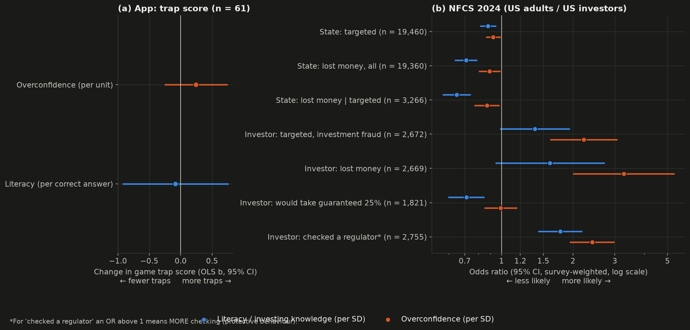

| Role | Outcome | Prediction | Test | Statistic | p | Holm p | Effect [95% CI] | n | Direction |
| --- | --- | --- | --- | --- | --- | --- | --- | --- | --- |
| Secondary (dataset) | targeted by fraud | overconfidence OR > 1 (State-by-State, targeted by a fraud or scam (past year)) | Survey-weighted logistic regression (HC1 SEs) | z = -2.39 | 0.017 | – | OR = 0.92 [0.86, 0.99] | respondents 19460, events 3366 | opposite |
| Secondary (dataset) | targeted by fraud | literacy OR not protective (CI not entirely on the protective side) (State-by-State, targeted by a fraud or scam (past year)) | Survey-weighted logistic regression (HC1 SEs) | z = -3.66 | < 0.001 | – | OR = 0.88 [0.82, 0.94] | respondents 19460, events 3366 | opposite |
| Secondary (dataset) | lost money to fraud | overconfidence OR > 1 (State-by-State, lost money to a fraud (all respondents)) | Survey-weighted logistic regression (HC1 SEs) | z = -2.35 | 0.019 | – | OR = 0.89 [0.81, 0.98] | respondents 19360, events 1370 | opposite |
| Secondary (dataset) | lost money to fraud | literacy OR not protective (CI not entirely on the protective side) (State-by-State, lost money to a fraud (all respondents)) | Survey-weighted logistic regression (HC1 SEs) | z = -6.68 | < 0.001 | – | OR = 0.71 [0.64, 0.78] | respondents 19360, events 1370 | opposite |
| Secondary (dataset) | lost money (if targeted) | overconfidence OR > 1 (State-by-State, lost money (among those targeted)) | Survey-weighted logistic regression (HC1 SEs) | z = -2.43 | 0.015 | – | OR = 0.87 [0.77, 0.97] | respondents 3266, events 1370 | opposite |
| Secondary (dataset) | lost money (if targeted) | literacy OR not protective (CI not entirely on the protective side) (State-by-State, lost money (among those targeted)) | Survey-weighted logistic regression (HC1 SEs) | z = -6.55 | < 0.001 | – | OR = 0.65 [0.57, 0.74] | respondents 3266, events 1370 | opposite |
| Primary (dataset) | targeted by fraud | overconfidence OR > 1 (Investor Survey, targeted by investment fraud (primary)) | Survey-weighted logistic regression (HC1 SEs) | z = 4.90 | < 0.001 | – | OR = 2.22 [1.61, 3.06] | respondents 2672, events 127 | as predicted |
| Secondary (dataset) | targeted by fraud | investing knowledge (11-item quiz) OR not protective (CI not entirely on the protective side) (Investor Survey, targeted by investment fraud (primary)) | Survey-weighted logistic regression (HC1 SEs) | z = 1.91 | 0.057 | – | OR = 1.38 [0.99, 1.92] | respondents 2672, events 127 | as predicted |
| Secondary (dataset) | lost money to fraud | overconfidence OR > 1 (Investor Survey, lost money to investment fraud) | Survey-weighted logistic regression (HC1 SEs) | z = 4.78 | < 0.001 | – | OR = 3.27 [2.01, 5.31] | respondents 2669, events 56 | as predicted |
| Secondary (dataset) | lost money to fraud | investing knowledge (11-item quiz) OR not protective (CI not entirely on the protective side) (Investor Survey, lost money to investment fraud) | Survey-weighted logistic regression (HC1 SEs) | z = 1.76 | 0.078 | – | OR = 1.60 [0.95, 2.70] | respondents 2669, events 56 | as predicted |
| Secondary (dataset) | would take a guaranteed 25% offer | overconfidence OR > 1 (Investor Survey, would invest in a guaranteed risk-free 25% offer (yes vs no)) | Survey-weighted logistic regression (HC1 SEs) | z = -0.12 | 0.904 | – | OR = 0.99 [0.85, 1.15] | respondents 1821, events 606 | opposite |
| Secondary (dataset) | would take a guaranteed 25% offer | investing knowledge (11-item quiz) OR not protective (CI not entirely on the protective side) (Investor Survey, would invest in a guaranteed risk-free 25% offer (yes vs no)) | Survey-weighted logistic regression (HC1 SEs) | z = -3.93 | < 0.001 | – | OR = 0.71 [0.60, 0.84] | respondents 1821, events 606 | opposite |
| Robustness | guaranteed offer: yes or not sure | overconfidence OR > 1 (Investor Survey, guaranteed offer: yes or not sure vs no (robustness)) | Survey-weighted logistic regression (HC1 SEs) | z = -1.22 | 0.223 | – | OR = 0.92 [0.79, 1.06] | respondents 2785, events 606 | opposite |
| Robustness | guaranteed offer: yes or not sure | investing knowledge (11-item quiz) OR not protective (CI not entirely on the protective side) (Investor Survey, guaranteed offer: yes or not sure vs no (robustness)) | Survey-weighted logistic regression (HC1 SEs) | z = -4.31 | < 0.001 | – | OR = 0.72 [0.61, 0.83] | respondents 2785, events 606 | opposite |
| Secondary (dataset) | checked a regulator | overconfidence OR < 1 (Investor Survey, ever checked a regulator about a financial professional) | Survey-weighted logistic regression (HC1 SEs) | z = 8.18 | < 0.001 | – | OR = 2.41 [1.95, 2.97] | respondents 2755, events 448 | opposite |
| Secondary (dataset) | checked a regulator | investing knowledge (11-item quiz) OR not protective (CI not entirely on the protective side) (Investor Survey, ever checked a regulator about a financial professional) | Survey-weighted logistic regression (HC1 SEs) | z = 5.37 | < 0.001 | – | OR = 1.77 [1.44, 2.17] | respondents 2755, events 448 | opposite |
| Robustness | targeted by fraud | overconfidence OR > 1 (Investor Survey, targeted, + finfluencer use) | Survey-weighted logistic regression (HC1 SEs) | z = 3.77 | < 0.001 | – | OR = 1.87 [1.35, 2.59] | respondents 2647, events 125 | as predicted |
| Robustness | targeted by fraud | investing knowledge (11-item quiz) OR not protective (CI not entirely on the protective side) (Investor Survey, targeted, + finfluencer use) | Survey-weighted logistic regression (HC1 SEs) | z = 1.30 | 0.193 | – | OR = 1.27 [0.89, 1.82] | respondents 2647, events 125 | as predicted |
| Robustness | targeted by fraud | overconfidence OR > 1 (Investor Survey, targeted, Big Three literacy (linked by NFCSID)) | Survey-weighted logistic regression (HC1 SEs) | z = 0.78 | 0.436 | – | OR = 1.13 [0.83, 1.53] | respondents 2706, events 125 | as predicted |
| Robustness | targeted by fraud | Big Three literacy (linked State answers) OR not protective (CI not entirely on the protective side) (Investor Survey, targeted, Big Three literacy (linked by NFCSID)) | Survey-weighted logistic regression (HC1 SEs) | z = -2.47 | 0.013 | – | OR = 0.70 [0.53, 0.93] | respondents 2706, events 125 | opposite |

#### Replication check: our State-by-State odds ratios vs the teammate's NFCS report

| Outcome | Predictor | Ours [95% CI] | Teammate | Difference | > 0.02? |
| --- | --- | --- | --- | --- | --- |
| targeted by a fraud or scam (past year) | literacy | 0.88 [0.82, 0.94] | 0.88 | -0.00 | no |
| targeted by a fraud or scam (past year) | overconfidence | 0.92 [0.86, 0.99] | 0.92 | +0.00 | no |
| lost money to a fraud (all respondents) | literacy | 0.71 [0.64, 0.78] | 0.71 | -0.00 | no |
| lost money to a fraud (all respondents) | overconfidence | 0.89 [0.81, 0.98] | 0.90 | -0.01 | no |
| lost money (among those targeted) | literacy | 0.65 [0.57, 0.74] | 0.65 | -0.00 | no |
| lost money (among those targeted) | overconfidence | 0.87 [0.77, 0.97] | 0.88 | -0.01 | no |

All six odds ratios agree within 0.02 (largest absolute difference 0.01), so no difference needs explaining; every teammate value lies inside our 95% CI. Our specification: Big Three with don't know = wrong, z-scored literacy and overconfidence, national weights (wgt_n2), controls for financial education, age, gender, income, risk willingness and owning investments.

#### Reparameterization: one model, two readings of the literacy coefficient

a·z(lit) + b·(z(self) − z(lit)) = (a − b)·z(lit) + b·z(self). The two versions fit the data identically (the largest coefficient difference after the conversion is printed below, zero up to rounding). With overconfidence in the model, the literacy odds ratio compares people with the same overconfidence; with the self-rating in the model, it compares people with the same self-rating.

| Outcome | Literacy (at equal overconfidence) | Overconfidence | Literacy (at equal self-rating) | Self-rating | Max. difference |
| --- | --- | --- | --- | --- | --- |
| targeted by a fraud or scam (past year) | OR 0.88 [0.82, 0.94], p < 0.001 | OR 0.92 [0.86, 0.99], p = 0.017 | OR 0.94 [0.89, 0.99], p = 0.011 | OR 0.94 [0.89, 0.99], p = 0.017 | 4.9e-16 |
| lost money to a fraud (all respondents) | OR 0.71 [0.64, 0.78], p < 0.001 | OR 0.89 [0.81, 0.98], p = 0.019 | OR 0.78 [0.72, 0.84], p < 0.001 | OR 0.91 [0.84, 0.98], p = 0.019 | 3.6e-16 |
| lost money (among those targeted) | OR 0.65 [0.57, 0.74], p < 0.001 | OR 0.87 [0.77, 0.97], p = 0.015 | OR 0.73 [0.66, 0.80], p < 0.001 | OR 0.89 [0.81, 0.98], p = 0.015 | 6.4e-16 |

#### Where the app and the NFCS disagree

- **Literacy.** The game shows no evidence that literacy protects (b = -0.08 [-0.92, 0.75] traps per correct answer). In the State-by-State survey higher literacy goes with lower odds of fraud in 3 of 3 outcomes (targeted by a fraud or scam (past year): OR 0.88; lost money to a fraud (all respondents): OR 0.71; lost money (among those targeted): OR 0.65). Among investors, more investing knowledge does not lower the odds of being targeted by investment fraud (OR 1.38) but does lower the wish to take a 'guaranteed 25%' offer (OR 0.71).
- **Overconfidence.** In the game it is not significant (b = 0.24 [-0.25, 0.73], p = 0.331). Among investors it is a strong risk factor for being targeted by investment fraud (OR 2.22) and losing money (OR 3.27), but in the general population it goes with slightly lower odds of any fraud (ORs 0.92, 0.89, 0.87). With the Big Three instead of the investing quiz, the investor effect is OR 1.13 (p = 0.436).
- **Possible reasons:** (1) general vs investment fraud: the State survey asks about any financial fraud or scam, the Investor survey and the app are about investment fraud; (2) real vs simulated money: the app uses virtual rupees in a 7-minute game; (3) US adults and US investors vs Indian college students; (4) the ceiling effect in our literacy measure (66% of players scored 3 of 3, vs 31% in the State survey), which leaves almost no variation to detect protection; (5) 'targeted' is self-reported belief: overconfident, active investors may notice and report approaches more (they also checked a regulator more often, OR 2.41); (6) different knowledge measures (an 11-item investing quiz vs the Big Three).

**Verdict and what the data does NOT justify.**

- In the app, a non-significant result is not evidence of no effect: the 95% CI (0.24 [-0.25, 0.73]) is wide enough to include both no effect and a sizeable effect. The data cannot decide between them at this sample size.
- The app part is correlational: literacy and self-rating were measured, not assigned, and the trap score counts choices in a game, not real victimization.
- The dataset verdict rests on the pre-chosen primary model (Investor Survey, targeted by investment fraud). It does **not** justify a general claim that overconfidence makes people fall for fraud: in the State-by-State survey overconfidence goes with lower odds of fraud, and with the Big Three instead of the quiz the investor effect is not significant (OR 1.13).
- It does **not** justify 'literacy does not protect' in general: in the large US sample, literacy clearly goes with lower odds of being targeted and of losing money.
- 'Targeted' is a self-report of a belief, so a higher rate among overconfident investors may partly reflect noticing scams, not falling for them; the NFCS results are associations in US data, not causal effects for Indian students.
- Literacy coefficient -0.08 [-0.92, 0.75] traps per correct answer: there is **no evidence that literacy protects**, but the CI still allows a protective effect of up to 0.92 fewer traps per correct answer, so this is **not** evidence that literacy does not matter.

### H9 — The dominant bias differs by demographic group

**Verdict: SUPPORTED** (app + dataset) — dataset: SUPPORTED (primary outcome (lost money): gender p = 0.145, strongest bias is the same across groups; age group p = 0.005, strongest bias differs across groups; income group p = 0.702, strongest bias differs across groups); app part exploratory.

**What we claimed.** The bias that best predicts victimization differs across age, gender and income groups.

**How the experiment tests it.** App part (exploratory): the trap score is regressed on four measured biases (loss aversion, FOMO, overconfidence, CRT) and their interactions with gender. Age and income cannot be tested: almost all app players are 18–20 students. Main test: the NFCS 2024 State-by-State Survey (about 19,000 US adults). For gender, age group and income group, a joint Wald test asks whether the effects of the bias proxies (overconfidence, risk willingness) differ between groups; models within each group name the strongest bias. Primary outcome (fixed before fitting): lost money to a fraud.

**The maths.**

```text
trap_score_shared8 = β0 + Σ_b β_b·bias_b + γ·male + Σ_b δ_b·bias_b·male + ε   (HC3)
slope_b(not male) = β_b,   slope_b(male) = β_b + δ_b
H0: δ_b = 0 for each bias    (exploratory; no verdict beyond EXPLORATORY)

NFCS: logit P(lost money) = α + Σ_b β_b·bias_b + Σ_g γ_g·group_g + Σ_b Σ_g δ_bg·bias_b·group_g + controls
bias ∈ {z(overconfidence), z(risk willingness)};  group ∈ gender | age | income
H0: all δ_bg = 0 (joint Wald test, Holm over the three groupings)
```

**Result.**

Model sample: 58 players (male 40, not male 18). Gender in all completers: male 42, female 17, other 1, prefer_not 1. Age: 18_20 37, 21_23 11, 36_plus 10, 24_26 2, 27_35 1. Income: prefer_not 18, gt_25l 16, 12l_25l 13, 6l_12l 7, 3l_6l 5, lt_3l 2.

`la_group` × male: interaction b = -0.90 [-2.77, 0.98], p = 0.347.

`fomo_score` × male: interaction b = 0.16 [-0.95, 1.28], p = 0.772.

`overconfidence` × male: interaction b = -0.54 [-1.58, 0.50], p = 0.312.

`crt_correct` × male: interaction b = -1.00 [-3.88, 1.89], p = 0.498.

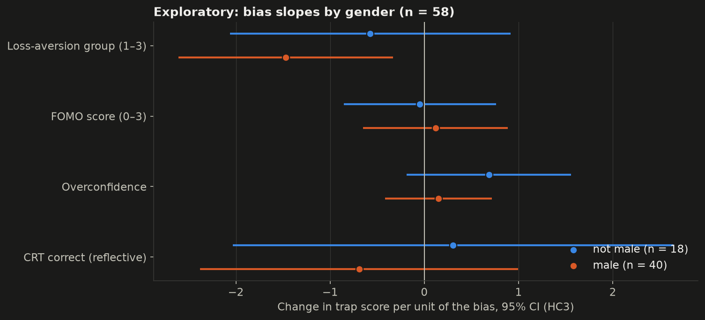

| Role | Outcome | Prediction | Test | Statistic | p | Holm p | Effect [95% CI] | n | Direction |
| --- | --- | --- | --- | --- | --- | --- | --- | --- | --- |
| Exploratory | trap score (shared 8) | slope of la_group differs between male and not-male players | OLS (HC3) with bias × male interactions | t = -0.94 | 0.347 | – | b = -0.90 [-2.77, 0.98] | players 58, male 40, not male 18 | – |
| Exploratory | trap score (shared 8) | slope of fomo_score differs between male and not-male players | OLS (HC3) with bias × male interactions | t = 0.29 | 0.772 | – | b = 0.16 [-0.95, 1.28] | players 58, male 40, not male 18 | – |
| Exploratory | trap score (shared 8) | slope of overconfidence differs between male and not-male players | OLS (HC3) with bias × male interactions | t = -1.01 | 0.312 | – | b = -0.54 [-1.58, 0.50] | players 58, male 40, not male 18 | – |
| Exploratory | trap score (shared 8) | slope of crt_correct differs between male and not-male players | OLS (HC3) with bias × male interactions | t = -0.68 | 0.498 | – | b = -1.00 [-3.88, 1.89] | players 58, male 40, not male 18 | – |

#### Dataset part: NFCS 2024 (United States)

**Dataset verdict: SUPPORTED** — primary outcome (lost money): gender p = 0.145, strongest bias is the same across groups; age group p = 0.005, strongest bias differs across groups; income group p = 0.702, strongest bias differs across groups. Survey-weighted logistic regression: GLM binomial, weights normalized to mean 1, HC1 robust SEs; odds ratios per SD.

**Data.** NFCS 2024 State-by-State Survey: 25,539 adults. Primary outcome (fixed before fitting): lost money to a fraud. Bias proxies: z(overconfidence) and z(risk willingness); literacy and the other controls are in every model. The within-group models are **exploratory**; Holm is applied over the three groupings within each outcome.

| Outcome | Grouping | Wald χ² (df) | p | Holm p | Strongest bias by group |
| --- | --- | --- | --- | --- | --- |
| targeted | gender | 2.3 (2) | 0.315 | 0.630 | female: risk willingness; male: risk willingness |
| targeted | age | 15.3 (10) | 0.121 | 0.364 | 18-24: risk willingness; 25-34: risk willingness; 35-44: risk willingness; 45-54: risk willingness; 55-64: overconfidence; 65+: overconfidence |
| targeted | income | 4.0 (4) | 0.407 | 0.630 | $100K+: overconfidence; $50K-$100K: overconfidence; <$50K: risk willingness |
| lost all | gender | 3.9 (2) | 0.145 | 0.289 | female: risk willingness; male: risk willingness |
| lost all | age | 25.3 (10) | 0.005 | 0.015 | 18-24: risk willingness; 25-34: risk willingness; 35-44: risk willingness; 45-54: risk willingness; 55-64: overconfidence; 65+: overconfidence |
| lost all | income | 2.2 (4) | 0.702 | 0.702 | $100K+: overconfidence; $50K-$100K: risk willingness; <$50K: risk willingness |
| lost targeted | gender | 2.7 (2) | 0.259 | 0.518 | female: overconfidence; male: risk willingness |
| lost targeted | age | 14.2 (10) | 0.163 | 0.490 | 18-24: risk willingness; 25-34: risk willingness; 35-44: risk willingness; 45-54: risk willingness; 55-64: overconfidence; 65+: risk willingness |
| lost targeted | income | 3.9 (4) | 0.424 | 0.518 | $100K+: overconfidence; $50K-$100K: risk willingness; <$50K: risk willingness |

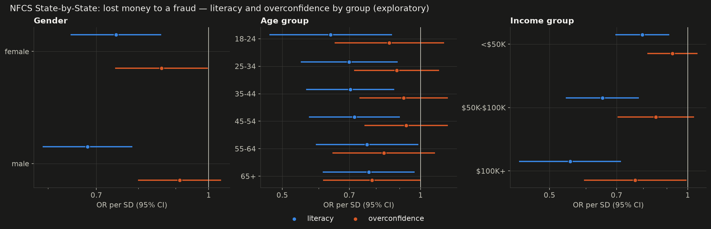

**Verdict and what the data does NOT justify.**

- With few non-male players and ten parameters, the app model cannot establish group differences; any pattern here is a hypothesis for the dataset part, not a finding.
- The dataset verdict rests on age (p = 0.005, Holm p = 0.015); the other groupings show no reliable difference. The 'strongest bias' in each group is a ranking of point estimates whose CIs overlap, so it is exploratory. US data: it does not show which bias matters most for Indian students or for age and income groups outside the US.

## 4. Survey: real-life evidence

Descriptive only (no randomization, not linked to the app players). 45 consenting respondents; 1 non-consenting row dropped. Approached by a suspicious investment or earning app/group: 34 of 43 who answered yes or no (79%, 95% CI 65%–89%); 2 were not sure. Of those approached, 23 of 34 said it happened in the past 12 months.

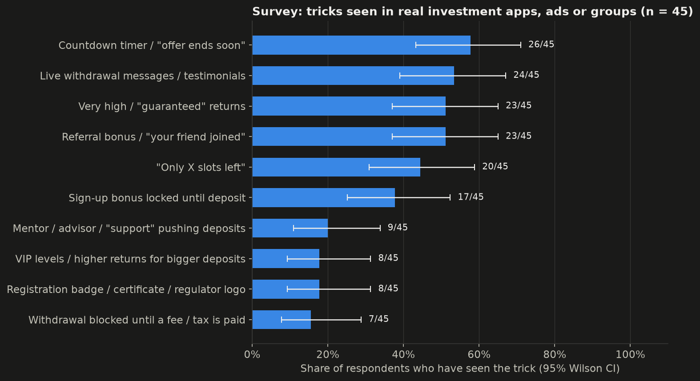

| Trick | Seen | Share [95% CI] |
| --- | --- | --- |
| Countdown timer / "offer ends soon" | 26/45 | 58% [43%, 71%] |
| Live withdrawal messages / testimonials | 24/45 | 53% [39%, 67%] |
| Very high / "guaranteed" returns | 23/45 | 51% [37%, 65%] |
| Referral bonus / "your friend joined" | 23/45 | 51% [37%, 65%] |
| "Only X slots left" | 20/45 | 44% [31%, 59%] |
| Sign-up bonus locked until deposit | 17/45 | 38% [25%, 52%] |
| Mentor / advisor / "support" pushing deposits | 9/45 | 20% [11%, 34%] |
| VIP levels / higher returns for bigger deposits | 8/45 | 18% [9%, 31%] |
| Registration badge / certificate / regulator logo | 8/45 | 18% [9%, 31%] |
| Withdrawal blocked until a fee / tax is paid | 7/45 | 16% [8%, 29%] |
| None of these | 7/45 | 16% [8%, 29%] |

**How approached respondents were first contacted:** Social media ad 17/34; Messaging group (WhatsApp / Telegram) 8/34; Cold call or SMS 6/34; Other 1/34; Influencer or celebrity promotion 1/34; Friend or family referral 1/34.

**What stopped them from putting money in** (24 of 31 approached non-investors answered; several reasons allowed):

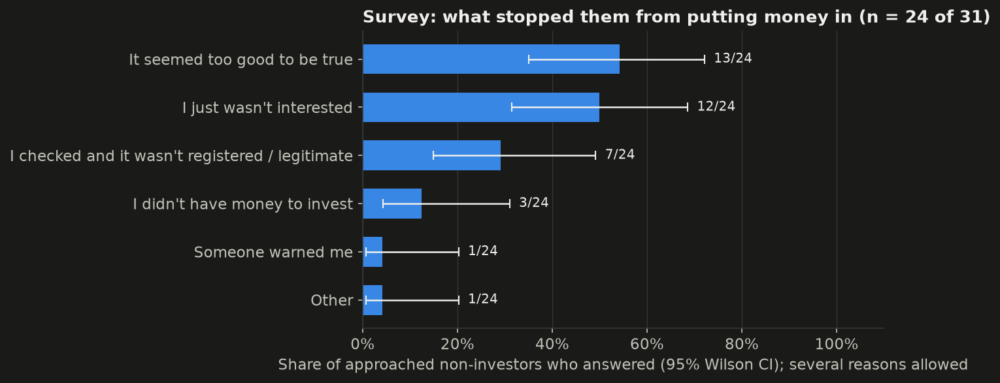

| Reason | Count | Share [95% CI] |
| --- | --- | --- |
| It seemed too good to be true | 13/24 | 54% [35%, 72%] |
| I just wasn't interested | 12/24 | 50% [31%, 69%] |
| I checked and it wasn't registered / legitimate | 7/24 | 29% [15%, 49%] |
| I didn't have money to invest | 3/24 | 12% [4%, 31%] |
| Someone warned me | 1/24 | 4% [1%, 20%] |
| Other | 1/24 | 4% [1%, 20%] |

**Respondents who put money in: 3 of 34 approached.** Too few for percentages or tests; counts only:

| Question | Item | Answers |
| --- | --- | --- |
| Q6 | First amount small (under ₹1,000) | yes 2 of 3, no 1, don't remember/blank 0 |
| Q7 | App showed profits early on | yes 1 of 3, no 1, don't remember/blank 1 |
| Q8 | A small withdrawal worked first | yes 1 of 3, no 2, don't remember/blank 0 |
| Q9 | Reinvested shown profits | yes 2 of 3, no 1, don't remember/blank 0 |
| Q10 | Put in more after a loss / blocked withdrawal | yes 0 of 3, no 3, don't remember/blank 0 |
| Q11 | Amount lost (counts per band) | Under ₹1,000: 1; ₹10,001–1,00,000: 1; ₹1,000–10,000: 1 |

**Common in real life vs persuasive in the app.** For the seven features both instruments measure: the share of survey respondents who have seen the trick, next to the share of fraud-skin players who said it pushed them to invest. Different people and different questions; read it as a map, not a test.

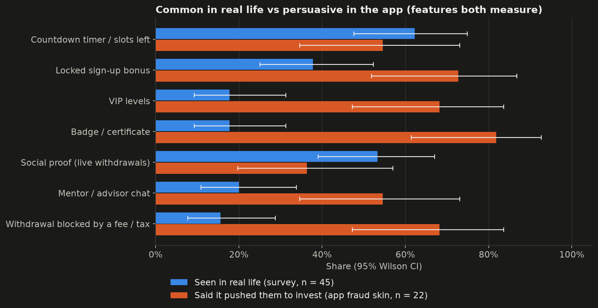

| Feature | Seen in real life (survey) | Pushed them (app, fraud) |
| --- | --- | --- |
| Countdown timer / slots left | 28/45 (62%) | 12/22 (55%) |
| Locked sign-up bonus | 17/45 (38%) | 16/22 (73%) |
| VIP levels | 8/45 (18%) | 15/22 (68%) |
| Badge / certificate | 8/45 (18%) | 18/22 (82%) |
| Social proof (live withdrawals) | 24/45 (53%) | 8/22 (36%) |
| Mentor / advisor chat | 9/45 (20%) | 12/22 (55%) |
| Withdrawal blocked by a fee / tax | 7/45 (16%) | 15/22 (68%) |

## 5. What held, what did not

**Held (supported or partly supported):**

- **H1d Fake credentials** — SUPPORTED: OR = 0.07 [0.01, 0.56], p = 0.002
- **H8 Literacy paradox** — PARTLY SUPPORTED: b = 0.24 [-0.25, 0.73], p = 0.331
- **H9 Bias by group** — SUPPORTED
- Secondary/robustness finding (not a verdict on its own): H1 round-1 stake — δ = 0.26 [0.03, 0.48], p = 0.037
- Secondary/robustness finding (not a verdict on its own): H1 trap score (shared 8) — δ = 0.35 [0.05, 0.63], p = 0.023
- Secondary/robustness finding (not a verdict on its own): H1d verification opens — δ = -0.37 [-0.54, -0.20], p = 0.003
- Secondary/robustness finding (not a verdict on its own): H8 targeted by fraud — OR = 1.87 [1.35, 2.59], p < 0.001

**Did not hold (not supported):**

- **H1 Dark design** — NOT SUPPORTED: δ = 0.26 [-0.07, 0.55], p = 0.102
- **H1a Timer / scarcity** — NOT SUPPORTED: δ = -0.11 [-0.40, 0.19], p = 0.494
- **H1b Locked bonus** — NOT SUPPORTED: OR = 1.47 [0.26, 8.30], p = 1.000
- **H1c VIP levels** — NOT SUPPORTED: OR = 0.53 [0.10, 2.87], p = 0.658
- **H1e Social proof** — NOT SUPPORTED: δ = -0.11 [-0.40, 0.19], p = 0.494
- **H1f Mentor chat** — NOT SUPPORTED: δ = 0.22 [-0.08, 0.51], p = 0.148
- **H2 Early win** — NOT SUPPORTED: δ = -0.09 [-0.39, 0.22], p = 0.551
- **H3 Small stakes** — NOT SUPPORTED: η²_Q = 0.02 [0.00, 0.09], p = 0.336
- **H4 Loss chasing** — NOT SUPPORTED: OR = 0.51 [0.24, 1.09], p = 0.084
- **H5 Friend referral** — NOT SUPPORTED: OR = 0.58 [0.19, 1.70], p = 0.416
- **H6 Test withdrawal** — NOT SUPPORTED: δ = -0.09 [-0.36, 0.21], p = 0.542
- **H7 House money** — NOT SUPPORTED: δ = -0.05 [-0.34, 0.23], p = 0.714

**No verdict possible yet / by design:**

- **H1g Withdrawal tax** — NOT TESTABLE
- **H1h UX map** — DESCRIPTIVE

## 6. Limitations

- **Sample:** 61 completers from one college population; 37 of 61 are aged 18–20 and 42 of 61 are male. Small groups give wide confidence intervals: many non-significant results are inconclusive, not evidence of no effect.
- **Differential attrition:** 22/62 fraud vs 39/62 honest players finished. Completer comparisons of the skins are not fully randomized comparisons (see the attrition section).
- **Bundled features (H1):** the fraud skin switches on all dark-design features together, so sub-hypotheses H1a–H1g cannot be separated causally; the feature cards are self-reports from fraud players only.
- **Ceiling effects:** 66% of players got all three literacy questions right, and round-1 investing was fraud 91%, honest 87%, which leaves little room for differences in H1b and H8.
- **Virtual money:** all amounts are virtual rupees in a short game; real losses, real friends and real apps carry stakes the experiment cannot reproduce.
- **Unequal length:** the honest skin is about a minute shorter (no chat, no feature cards, no tax screen); fatigue may differ for the late-game outcomes.
- **Multiple testing:** many outcomes were tested; Holm-adjusted p-values are shown, and verdicts use raw p-values as pre-registered.
- **Survey:** a separate convenience sample, not linked to the app players; only 3 respondents had invested, so the victim-sequence questions are counts only.
- **NFCS datasets (H8, H9):** US adults and US investors, not Indian students; cross-sectional associations, not causal effects; victimization is self-reported for the past year, and being 'targeted' partly measures noticing an approach. The State-by-State survey covers any financial fraud, not only investment fraud.
